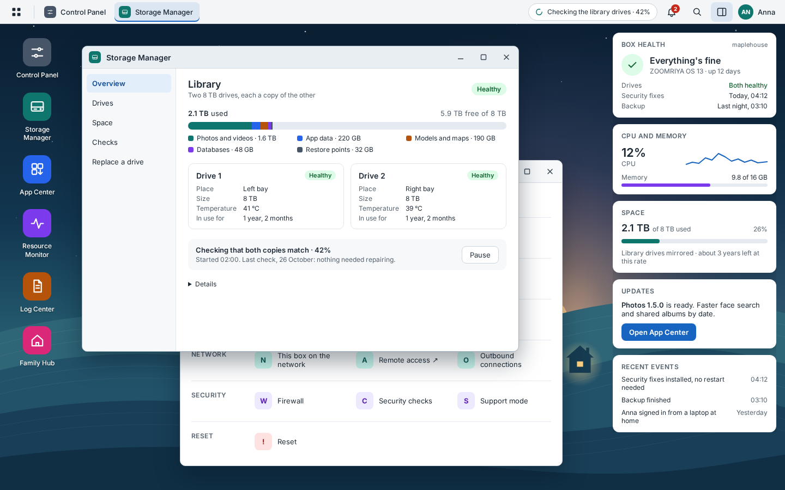

# ZOOMRIYA OS

**A simple, secure operating system for the ZOOMRIYA Box.**

ZOOMRIYA OS powers the ZOOMRIYA Box. Based on Debian 13, it is designed for a
home server that should be reliable, secure and easy to maintain.

The box should take care of itself. Families should not need to manage Linux,
containers or routine security updates. Administrators manage the box through
Box Desktop; ZOOMRIYA OS looks after the system underneath.

## Why ZOOMRIYA OS?

ZOOMRIYA OS is designed to feel less like managing a server and more like
using an appliance. There is no Docker dependency, and normal administration
does not require command-line work.

Applications run in their own versioned `systemd-nspawn` images, separate
from the operating system. This lets applications be updated independently
of the base system. If an update causes a problem, the system is designed to
return to a known-good version.

Debian security updates install automatically. Application updates are
installed when an administrator chooses to update them.

## How it works

ZOOMRIYA OS starts with a minimal Debian 13 installation. Its main components
are:

- **Debian 13** — the operating system foundation.
- **systemd** — manages system services.
- **systemd-nspawn** — runs applications in separate, versioned images.
- **Btrfs** — provides system snapshots and rollback.
- **ZOOMRIYA Agent** — performs privileged system operations.
- **Box Desktop** — gives administrators a graphical way to manage the box.
- **mkosi** — builds the operating system image.

The operating system and applications have separate update and recovery
paths. A failed application update can be rolled back to its previous image.
If a new kernel does not boot, the system can fall back to the previous
kernel.

## Security

ZOOMRIYA OS uses a minimal system and a default-deny security approach. Its
security measures include:

- A default-deny firewall, AppArmor and `auditd`.
- Sandboxed services and a minimal set of installed packages.
- SSH disabled by default.
- Optional key-only SSH, restricted to the home network.
- Temporary support access that an administrator explicitly enables.

The box stays closed to remote access by default. Support access is not
permanently exposed; an administrator enables it only when needed and for a
limited time.

## Box Desktop

Administrators use Box Desktop on the box's own screen. It provides graphical
tools for tasks such as:

- Checking storage and system resources.
- Installing updates and viewing restore points.
- Restoring the system.
- Viewing logs and managing system settings.

Family members do not need to manage the operating system. Their normal
experience is using the ZOOMRIYA applications that run on the box.

## Project status

ZOOMRIYA OS is an early-stage project. The system image can be built and
booted in a virtual machine. Automatic Debian security updates, restore
points and system restore, and fallback to a previous kernel are part of the
current system work. The ZOOMRIYA Agent and Box Desktop have their first
working features; other parts are still being developed.

The Box Desktop screenshot below is from its mockup.



## Build and test

Build on Debian 13. You also need the
[ZOOMRIYA ID repository](https://github.com/zoomriya/zoomriya-id) checked out
beside this repository, or set `ZOOMRIYA_ID_SRC` to its location.

Run the setup script once. It checks the build environment, installs missing
dependencies (asking for `sudo` if needed), and checks KVM support:

```sh
scripts/setup.sh
```

Then use the scripts for the build and test workflow:

```sh
scripts/build-image.sh       # build/image/zoomriya-os.raw
scripts/test-vm.sh           # boot the image and run tests/vm/check.sh
scripts/run-vm.sh            # explore the image in a virtual machine
scripts/build-installer.sh   # build/installer/zoomriya-installer.raw
scripts/run-installer-vm.sh  # test installation to an empty 64 GB virtual disk
scripts/preview-desktop.sh   # run Box Desktop here with sample data
```

The development VM started by `run-vm.sh` uses the password `rootroot` for
its root account. This is only for that development VM; it is not a password
in the operating system image.

## Documentation

| Document | Description |
| --- | --- |
| [Design](docs/design.md) | System structure, storage, boot, recovery, updates, security, and development plan |
| [Installing](docs/install.md) | Building the installer, installing ZOOMRIYA OS, and first setup |
| [Box Desktop](docs/box-desktop.md) | The administrator desktop, its tools, and how it is built |
| [Licences](docs/licences.md) | Third-party components and their licences |

## Licence and trademarks

ZOOMRIYA OS is licensed under [MPL-2.0](LICENSE). Changes to files covered
by the licence remain available under its terms and may be combined with
other software under that software's own terms.

The ZOOMRIYA name and logo are trademarks and are not covered by the software
licence. See [TRADEMARKS.md](TRADEMARKS.md). Third-party software keeps its
own licence; see [Licences](docs/licences.md).

## The ZOOMRIYA platform

- **ZOOMRIYA OS** — the operating system for the ZOOMRIYA Box.
- **ZOOMRIYA ID** — identity and sign-in.
- **ZOOMRIYA Apps** — the applications running on the box.
- **ZOOMRIYA Connect** — remote connectivity.

ZOOMRIYA OS stays in the background so families can focus on using their
applications, not maintaining a server.
