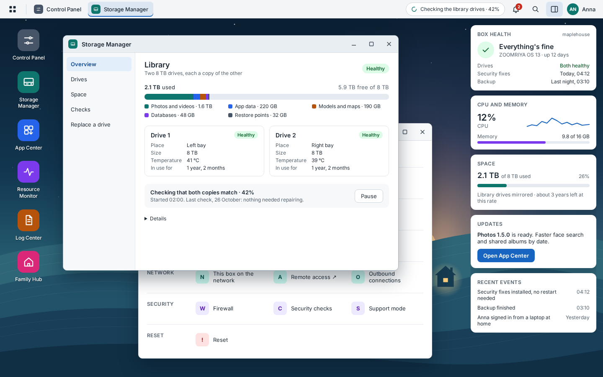
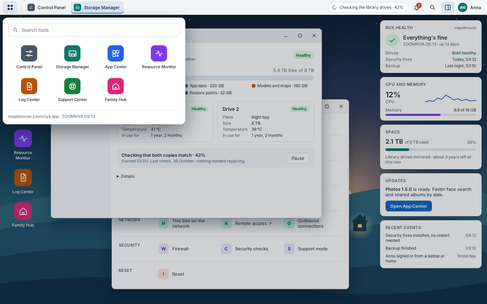
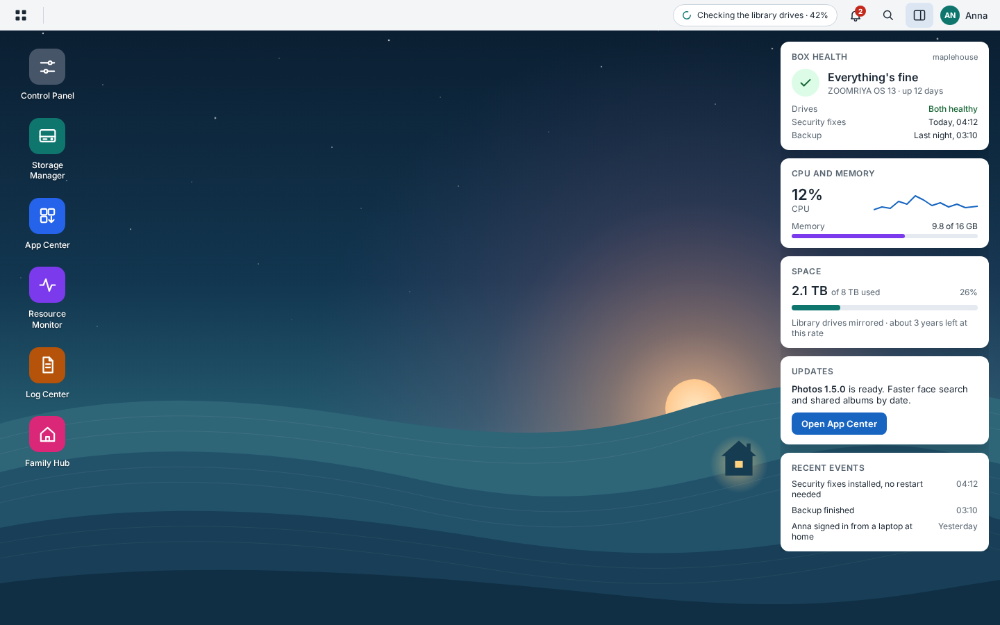

# Box Desktop: design

November 4, 2026 · built in part; this says what's built and what's planned

Box Desktop is ZOOMRIYA OS's own desktop for the box's admins, on the box's
own screen: storage, updates, restore points, resources, logs, the box's
settings and reset, in windows on a desktop, with a top bar, a main menu,
widgets, and tools that open as windows. It plays and records sound through
the box's speakers and microphone.

It is part of ZOOMRIYA OS and lives in this public repository
(`box-desktop-app`). Family Hub, the family's front door, lives in
zoomriya-apps and stays private; using the box from elsewhere is Family Hub's
and the apps'. Box Desktop talks to `zoomriya-agent`
([Design §7](design.md#7-zoomriya-agent)) and to ZOOMRIYA ID's sign-in
([§7](#7-signing-in)), and contains no code from zoomriya-apps.

**Contents**

1. [Decisions](#1-decisions)
2. [Who sees it and where](#2-who-sees-it-and-where)
3. [The desktop](#3-the-desktop)
4. [The tools](#4-the-tools)
5. [Words](#5-words)
6. [How it's built](#6-how-its-built)
7. [Signing in](#7-signing-in)
8. [Security](#8-security)
9. [What it doesn't do](#9-what-it-doesnt-do)
10. [Open decisions](#10-open-decisions)
11. [Plan](#11-plan)

## 1. Decisions

| Decision | State |
| --- | --- |
| The box's system controls are Box Desktop's, in this public repository, not Family Hub's | Decided |
| On the box's own screen, a native app (GTK 4 in Python under sway, like the first setup) | Decided |
| A desktop with windows, top bar, main menu and widgets, with our own look, icons and names | Decided |
| Admins only; other members never see it | Decided |
| `zoomriya-agent` stays the only part that runs as root; Box Desktop runs as its own user and asks the agent ([§6](#6-how-its-built)) | Decided |
| Plain words first, the technical details one click away ([§5](#5-words)) | Decided |

## 2. Who sees it and where

- **On the box's screen,** once the box is set up: tty1 shows Box Desktop's
  sign-in, with a keyboard, a mouse and a monitor plugged into the box.
- **Admins only.** An admin signs in with their ZOOMRIYA ID; anyone else is
  told Box Desktop is for the box's admins ([§7](#7-signing-in)).
- **From elsewhere, it's Family Hub and the apps.** Box Desktop listens on no
  network port.
- **First boot is apart from it.** The first setup runs on the same screen
  ([Design §5](design.md#5-first-boot)) and makes the admin in ZOOMRIYA ID;
  Box Desktop starts once that's done.

## 3. The desktop



*From the mockup; the names, sizes and times are examples.*

**The taskbar**, along the top:

| Left | Middle | Right |
| --- | --- | --- |
| The main menu button, the ZOOMRIYA mark | One button per open window; click to bring it forward or minimise it | A restart that's needed; notifications; the sound's volume; search; Daylight or Midnight; the widgets; the clock; the admin's menu (Restart the box, Sign out) |

**The main menu** shows every tool as a large icon, with a search box. Any
tool can be dragged to the desktop as a shortcut. The desktop starts with
Control Panel, Storage Manager, App Center, Resource Monitor and Log Center.



**Windows** open, move, resize, minimise, maximise and close like a
computer's. Several can be open at once, and the same tool opens once (a
second click brings it forward). Each window has its sections down the left
side. Box Desktop remembers, per admin, which windows were open, where they
were, the desktop shortcuts and the widgets, so their next sign-in looks the
same.

**Widgets**, in a panel on the right that can be hidden: Box health, CPU and
memory, Space, Network, Backups, Updates. The admin picks which and in what
order. Each opens its tool when clicked. The box's events aren't a widget:
they're in Notifications (and in full in Log Center).

**Notifications** come from the agent's watcher (`zoomriya-agent watch`), which
runs every quarter of an hour, after each security update and after each
check of the library, and writes what changed into the journal: a drive's
health changed, security fixes installed, a restart planned, the library's
check finished or found a problem, network settings not kept and undone; later
support mode and backups. The bell in the top bar lists the latest, newest
first, with a count of the ones since the admin last read them, and links to
Log Center › Notifications, which keeps the last month's. Each
admin turns kinds on or off in Control Panel › Notifications; their choices
are kept with their own settings ([§6](#6-how-its-built)). Family Hub's box
card shows the same few that matter to a family.

**Keyboard and screen readers.** Every window, menu and widget can be reached
and used with the keyboard (Tab between windows' parts, Escape to close a
menu, a shortcut for the main menu). Windows are labelled regions, and
background jobs and notifications are announced.

**Daylight and Midnight**, the apps' two themes: Daylight unless the admin
switches, with the switch in the taskbar. Each admin's choice is kept in their
settings ([§6](#6-how-its-built)), like their mouse and keyboard.

**The wallpaper** is our own: dusk over the hills, with one house's window
lit ([`images/box-desktop-wallpaper.svg`](images/box-desktop-wallpaper.svg)).
The left side stays dark so the shortcuts' labels read well. An admin can
pick another image or a plain colour from their menu.



## 4. The tools

Each tool is a window with sections down its left side. Where its data comes
from is in the last column; requests marked *new* are added to the agent
([Design §7](design.md#7-zoomriya-agent)).

### Control Panel

The box's settings, each section in the list down the window's left. A
section shows its settings in rounded groups of rows on a quieter page: each
row a title with a line of explanation under it and its control on the right
(a switch, a list, Left | Right, a slider), and status at the top where it
helps (Security's Protected and Secure Boot). Every row says what it does in
plain words.

| Group | Section | What's in it | From |
| --- | --- | --- | --- |
| | Display | The box's own screen, since every family's monitor is different: orientation, resolution (with its shape, 16:9), refresh rate, scale. A change shows at once and goes back by itself after 15 seconds unless Keep is pressed; kept, it's the box's, for whoever signs in, and the screen starts that way from then on (`/etc/zoomriya/display.conf`, which screen-session adds to sway's settings). Only on the box's screen | `display-set` |
| | Sound | Which speakers and microphone (when there's more than one), their volume and mute, a test sound, and what the microphone hears. Only when the box has a sound card | PipeWire, Box Desktop's own |
| | Keyboard & Mouse | Each admin's own, like the theme. Keyboard: the layout (English, French, German…) of a keyboard plugged into the box; the box uses the last one an admin saved, and each admin's own when they sign in on the box. Mouse, for one plugged into the box: the primary button (Left or Right), pointer speed, acceleration, scroll direction (traditional or natural); inside Box Desktop on another computer, the mouse follows that computer | `keyboard`, `keyboard-set`; preferences |
| | Language & Region | The box's language and its country or region (the first setup's), with a note that ZOOMRIYA's own screens are in English for now | `setup-status`, `language-set`, `region-set` |
| | Date and time | The date and time now, the time zone, whether the clock is set from the internet | `setup-status`, `time-zone-set` |
| | Restarts | The maintenance hour, a planned restart, Restart now, Shut down | `maintenance-hour`, `restart`, `shutdown` *new* |
| Updates | Update and restore | Debian's security fixes (installed by themselves, with the last one's date), ZOOMRIYA OS 14 when it's offered ([Design §6.6](design.md#66-moving-to-debian-14)), the update history | `status`, `os-upgrade` |
| | Restore & Reset | From the mildest fix to the most drastic: the restore points (the OS's snapshots by date, and Restore to this point); Reset the system; and apart at the bottom, Erase everything ([Design §4](design.md#4-boot-recovery-and-factory-reset)). Each asks for the admin's password again; Erase everything also for the setup code | `restore-point-list`, `restore-point-restore`, `factory-reset` |
| Family | Family members | A link to Family Hub's Manage Family: accounts belong to ZOOMRIYA ID, not to the OS | none |
| Network | This box on the network | The box's name, each port's address, the router, the cable's speed, and whether ZOOMRIYA Connect is on (it needs the cable); each Ethernet port by DHCP or a fixed address, with Keep these settings ([Design §5.2](design.md#52-a-fixed-address)) | `network`, `network-set`, `network-keep` |
| | Wi-Fi | Join the home Wi-Fi, its signal, Forget; says that reaching the box away from home still needs the cable ([Design §5.1](design.md#51-wi-fi)) | `wifi` *new* |
| | Remote access | A link to Family Hub's Remote access page, where ZOOMRIYA Connect's settings are | none |
| | Outbound connections | What the box connects to and why, with the switches ([Design §6.1](design.md#61-debian-security-fixes)) | `network` *new* |
| Security | Security & Privacy | Security updates (automatic, the last installed); the firewall, what it lets in and why, read only; the last file integrity check and what changed, AppArmor, Secure Boot; Privacy: that the box reports nothing about the family, and every host on the internet it connects to and why | `security` |
| | Notifications | Each kind of notification on or off, for this admin, and See past notifications (Log Center) | none (Box Desktop's own) |
| | Advanced access | SSH for admins: on or off, the keys (added from a USB stick or pasted), the box's host key fingerprint ([Design §7.1](design.md#71-advanced-access)) | `advanced-access` *new* |
| | Support mode | Turn on for 1 to 24 hours, the time left, Turn off now | `support-mode` |
| Box | System Info | The ZOOMRIYA mark and the box's name; its name, model and serial, System OS ("ZOOMRIYA OS 13" and the factory image), the processor, memory, disk capacity, temperature, how long it's run, the time zone, who's signed in; and under Details: Debian's point release, `zoomriya-base`, the factory image, the kernel. Last in the list | `status`, `resources`, `storage`, `setup-status` |

### Storage Manager

| Section | What's in it | From |
| --- | --- | --- |
| Overview | The library's space used and free, the mirror's state, each drive's health in one line | `storage` *new*, `disk-health` |
| Drives | Each drive: its place, model, size, hours on, temperature, health ("Healthy", "Check soon", "Replace now" with the reason), and its SMART details under Details | `disk-health` |
| Space | What takes the space: photos and videos, each app's data, the databases, models and maps, restore points | `storage` *new* |
| Checks | The mirror's last and next check (a Btrfs scrub, OS-4), Check now, what it repaired | `storage` *new*, `storage-check` *new* |
| Replace a drive | Step by step, with pictures of the box: which drive, when it's safe to pull it, and the rebuild's progress | `storage` *new* |

Box Desktop never formats, mounts or unmounts a drive itself; that stays with
Photos' `storaged`, and the Replace a drive steps call it through the agent.

### App Center

| Section | What's in it | From |
| --- | --- | --- |
| Installed | Each app with its version, running or not, and its health; Update when a release is ready, Restore previous version | `apps`, `app-update`, `app-restore` |
| Updates | Releases waiting, with what changed; security rebuilds that installed by themselves ([Design §6.3](design.md#63-security-fixes-inside-app-images)) | `apps` |
| History | Every update and restore, its result, and its logs when it rolled back | `apps`, `logs` *new* |

An app's own settings stay in the app. App Center only installs, restores and
shows health; whether it can also install or remove apps waits for a catalogue
of apps (not designed yet).

### Resource Monitor

| Section | What's in it | From |
| --- | --- | --- |
| Overview | CPU, memory, network and drive activity, live, with the last hour and the last week | `resources` *new* |
| By app | The same for each app and shared service, from its systemd units' cgroups, so "Photos is using most of the CPU" can be seen at once, with what it's doing ("Finding faces") where the app says | `resources` *new* |
| Temperature | The CPU's and drives' temperatures and the fan | `resources` *new* |

### Log Center

| Section | What's in it | From |
| --- | --- | --- |
| Box events | Updates, restarts, drive health, backups, support mode, in plain words | `logs` *new* |
| Notifications | The last month's notifications, newest first, with their kind, including the kinds an admin turned off on their bell; Control Panel › Notifications and the bell link here | `notifications` |
| Admin actions | The audit log: who asked the agent for what, and when ([Design §7](design.md#7-zoomriya-agent)) | `logs` *new* |
| Sign-ins | Admins' sign-ins to Box Desktop, with the device | `logs` *new* |
| System log | The whole journal, for support: errors, warnings or everything, and a search | `logs` |
| Diagnostics | Make the diagnostics bundle and download it, or send it to support | `diagnostics` |

Logs are shown filtered and in plain words first; the journal's own lines are
under Details, for support. No family content is ever in them.

### Support Center

What support mode is, turning it on (the same switch as Control Panel's), the
diagnostics bundle, and how to reach us. The help pages for every tool open
here too.

## 5. Words

Storage tools are usually written for people who know what a volume and a RAID
group are. Box Desktop is for a parent who is the family's admin, so:

- **Plain words first.** "Library drives", "Healthy", "Check soon", "Restore
  to this point", "The box will restart at 3:30 tonight". The technical names
  (Btrfs, SMART, snapper, nftables, unit names) are under each section's
  Details, for support and for those who want them.
- **Every warning says what to do:** "Drive 2 should be replaced soon. Your
  photos are safe on drive 1. Order a 4 TB or larger drive", with a link.
- **Every risky button says what it changes and what it keeps**, as the
  factory reset table in [Design §4](design.md#4-boot-recovery-and-factory-reset) does.

## 6. How it's built

```
the box's screen (tty1)
  └ sway, one app full screen (zoomriya-setup's screen-session)
      └ box-desktop-app.service     its own user, groups zoomriya-box and audio
          ├ ZOOMRIYA ID's sign-in    on the box itself (127.0.0.1)
          ├ PipeWire                 the speakers and the microphone
          └ zoomriya-agent           Unix socket, group zoomriya-box
                                     root, fixed requests only
```

- **`box-desktop-app`,** a package in this repository: GTK 4 in Python, run by
  `box-desktop-app.service` on tty1 once the box is set up, under sway, which
  shows it full screen with nothing else (no keys, bars or menus of sway's
  own). Drawn in software, so any screen works, with or without a graphics
  driver.
- **The agent does everything that changes the box,** in the signed-in
  admin's name, for its audit log. Box Desktop changes only what belongs to
  its own screen and session: the keyboard's layout and the mouse while it
  runs, the screen's resolution while an admin tries it (kept for the box by
  the agent's `display-set`), and the sound's volume.
- **Each admin's own settings:** one record per admin in Box Desktop's state
  folder (`/var/lib/box-desktop-app/admins`), named by a hash of their member
  id, readable by its account only: the theme, the keyboard layout and the
  mouse, the notifications they've turned off or read, and their desktop
  (windows, where they were). Written whole (a new file, then renamed), and
  checked when read, so a damaged one is the defaults. Where these should
  live so an OS restore doesn't take them back is BD-4.
- **Packaged with the OS**, as a `.deb` from our apt repository like
  `zoomriya-base` and `zoomriya-agent`; it updates with ZOOMRIYA OS's own
  releases, not with the apps.
- **The look is ours:** our own icons, colours, artwork and names, and the
  ZOOMRIYA logo. Its two themes are the apps' own: Daylight, the default, and
  Midnight, chosen by each admin in the top bar and kept with their settings.
  Every library, font and icon goes through [Licences](licences.md) first.
- **Seen without a box:** `scripts/preview-desktop.sh` runs it in a window
  with sample data.

## 7. Signing in

Box Desktop has no accounts of its own. [ZOOMRIYA ID](https://github.com/zoomriya/zoomriya-id)
signs people in, as it does for every app: Box Desktop sends the username and
password to ZOOMRIYA ID on the box (`/id/api/v1/auth/login`), asks who that is
(`/auth/me`), and lets in only an admin. Signing out ends the session in
ZOOMRIYA ID too. Each sign-in, and each refusal, goes into the journal for Log
Center's Sign-ins.

**Risky actions ask for the password again**: Erase everything, Reset the
system, Restore to this point, Shut down, and later turning on support mode or
advanced access. Box Desktop checks it with ZOOMRIYA ID before it asks the
agent; Erase everything also needs the setup code from the sticker.

## 8. Security

- **Admins only,** checked with ZOOMRIYA ID at every sign-in.
- **No network port.** Box Desktop listens on nothing; it's reached only by
  sitting at the box.
- **Its own user,** in groups `zoomriya-box` (the agent's socket) and `audio`,
  never root.
- **Every action goes into the agent's audit log** with the admin who asked.
- **The agent still accepts only its fixed requests.** Box Desktop adds no
  way to run a command; a bug in it can do no more than an admin pressing its
  buttons.

## 9. What it doesn't do

- **No terminal.** A command line is only through advanced access's SSH, from
  the home network ([Design §7.1](design.md#71-advanced-access)).
- **No files.** Photos and Vault keep the family's files; Box Desktop never
  shows their content, only how much space they take.
- **No family accounts or app settings.** Those stay in Family Hub and the
  apps.
- **No apps from others,** and no way to run anything that isn't one of our
  signed app images.
- **No content from the family in logs, notifications or the diagnostics
  bundle.**

## 10. Open decisions

| # | Decision | Options | State |
| --- | --- | --- | --- |
| BD-1 | Its name | Box Desktop: the package `box-desktop-app` | Decided |
| BD-2 | Family Hub's own Update button | (a) keep a short Update / Restore on Family Hub's box card, (b) only the box's health there, with updates on the box's screen | Open |
| BD-3 | Notifications reaching an admin's phone | (a) Family Hub's notifications show the important ones, (b) Box Desktop only | Leaning (a) |
| BD-4 | Where each admin's settings live | (a) Box Desktop's state folder on `@`, as now, which an OS restore takes back to the restore point's, (b) under `/data`, which a restore doesn't touch ([Design §3](design.md#3-the-disk), OS-10) | Open |

## 11. Plan

1. **The desktop on the box's screen.** Done: the sign-in with ZOOMRIYA ID,
   the top bar (the main menu, the open windows, notifications, the volume,
   search, the theme, the widgets, the clock, the admin's menu), shortcuts,
   widgets (Box health, CPU and memory, Space), and windows that move,
   minimise and maximise; Daylight and Midnight; each admin's settings.
2. **Control Panel.** Done: Network (each port, DHCP or a fixed address with
   Keep these settings), Display, Sound, Keyboard & Mouse, Language & Region,
   Date and time, Notifications, Security, Restarts, Restore & Reset,
   System Info. Next: Wi-Fi, Outbound connections, Advanced access,
   Support mode, Update and restore.
3. **Storage Manager, Resource Monitor and Log Center.** Done: Storage
   Manager's Overview, Drives and Space; Resource Monitor's Overview, By app
   and Temperature; Log Center's Box events, Admin actions, Sign-ins and
   System log. Next: the library's checks and Replace a drive; Diagnostics.
4. **App Center,** on the agent's `apps`, `app-update` and `app-restore`.
5. **Support Center.**
6. **Family Hub:** its box card (zoomriya-apps).
7. **Tested in CI** with the rest of the OS ([Design §10](design.md#10-building-and-testing)):
   the agent's requests in a VM, and Box Desktop's own checks.
