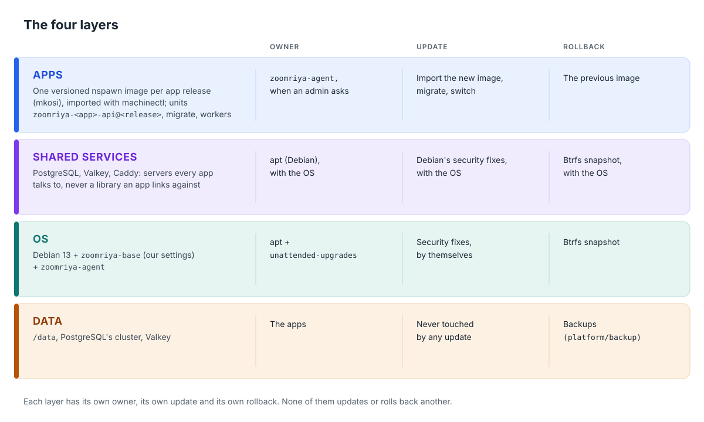

# ZOOMRIYA OS: design

Design and implementation status · November 2, 2026

ZOOMRIYA OS is the system that runs the ZOOMRIYA Box. It is based on Debian 13
and is designed to stay out of the family's way: family members use Family
Hub, while administrators manage the box through [Box Desktop](box-desktop.md).
Box Desktop is a web desktop, opened in a browser on the home network or on
the box's own screen. It provides tools for storage,
updates, restore points and resets, without requiring a terminal for routine
administration.

ZOOMRIYA OS is not a separate Linux distribution or a fork of Debian. It is a
carefully configured Debian 13 system, with our settings package
(`zoomriya-base`), a small privileged helper (`zoomriya-agent`) and an image
build. The apps and box service are developed in the private `zoomriya-apps`
repository. The box sets up [ZOOMRIYA ID](https://github.com/zoomriya/zoomriya-id)
for sign-in, while [ZOOMRIYA Connect](https://github.com/zoomriya/zoomriya-connect)
provides remote access. This document describes the system beneath those
services.

**Contents**

1. [Decisions](#1-decisions)
2. [The layers](#2-the-layers)
3. [The disk](#3-the-disk)
4. [Boot, recovery and factory reset](#4-boot-recovery-and-factory-reset)
5. [First boot](#5-first-boot)
6. [Updates](#6-updates)
7. [zoomriya-agent](#7-zoomriya-agent)
8. [Hardening](#8-hardening)
9. [Names and versions](#9-names-and-versions)
10. [Building and testing](#10-building-and-testing)
11. [Layout](#11-layout)
12. [Open decisions](#12-open-decisions)
13. [Plan](#13-plan)

## 1. Decisions

| Decision | State |
| --- | --- |
| Debian 13 minimal is the base | Decided |
| systemd runs everything; apps are isolated with systemd-nspawn and unit sandboxing, as Photos' API is today | Decided |
| Every update can be rolled back, the OS's and the apps' | Decided |
| An update or upgrade of the OS must not affect the apps ([§2](#2-the-layers)) | Decided |
| Every app's image carries all its dependencies (its Python, `ffmpeg`, libraries, its own binaries such as Qdrant). Nothing on the host is there for an app, so a Debian fix on the host can never break an app ([§2](#2-the-layers)) | Decided |
| We fix the apps' dependencies with our own app releases, including security rebuilds; Debian's security fixes on the host are for the OS alone ([§2](#2-the-layers), [§6.3](#63-security-fixes-inside-app-images)) | Decided |
| SSH is off by default. An admin may turn on advanced access: key-only SSH as `admin`, with `sudo`, from the home network only ([§7.1](#71-advanced-access)). ZOOMRIYA support never signs in to a box: it works from the diagnostics bundle an admin sends ([§7.2](#72-getting-help-the-diagnostics-bundle)) | Decided |
| The box's system controls are [Box Desktop](box-desktop.md), a web desktop for admins, in a browser on the home network or on the box's own screen, in this public repository | Decided |
| Only components whose licences allow use in a product we sell; each is checked in [Licences](licences.md) before it goes into an image | Decided |
| Valkey (BSD-3-Clause, [Licences](licences.md)) is the shared key-value store | Leaning |
| Debian's security fixes for the OS install by themselves, so we don't release anything for them ([§6.1](#61-debian-security-fixes)) | Decided (OS-2) |
| The root filesystem stays writable (apt updates it) with Btrfs snapshots for rollback. A read-only A/B system is a later step, built from the same packages ([§6.7](#67-later-a-read-only-system)) | Decided (OS-1) |
| ZOOMRIYA OS has its own numbers, one per Debian release: ZOOMRIYA OS 1 is built on Debian 13, 2 on Debian 14. "Alpha" until the first release. Each app keeps its own version ([§9](#9-names-and-versions)) | Decided 2026-11-10 |
| The box is set up and runs over Ethernet; Wi-Fi stays off, shown turned off in Box Desktop on a box that has it ([§5.1](#51-wi-fi)) | Decided (OS-14) |
| One name per box, `<name>.zoomriya.app`, with a real certificate; `.local` names are for first boot only ([§5](#5-first-boot)) | Decided ([ZOOMRIYA Connect](https://github.com/zoomriya/zoomriya-connect/blob/main/docs/sharing-and-names.md)) |
| HTTPS at home from the first start, with the box's own certificate for `<name>.local` and its home addresses, made and watched by the agent; the real certificate joins it once ZOOMRIYA Connect works ([§8.1](#81-secure-connections-at-home)) | Decided (2026-11-09) |
| Hardening is our own list in `zoomriya-base`, checked in CI, with every difference from common advice written down ([§8](#8-hardening)) | Decided |
| Support by how the OS was got: a ZOOMRIYA Box has full support, and its hardware 1 year; the official image on one's own PC, support on tested hardware and best effort elsewhere; self-built or changed, community only ([§7.3](#73-who-gets-what)) | Decided |
| `apt.zoomriya.com` serves every box, not locked; forks run their own ([§7.3](#73-who-gets-what)) | Decided |
| ZOOMRIYA Connect serves boxes registered to a ZOOMRIYA account; forks run their own Connect ([§7.3](#73-who-gets-what)) | Decided |
| Security updates follow Debian's releases: each ZOOMRIYA OS version gets them as long as its Debian version does, LTS included, and boxes move to the next version before that ends ([§6.6](#66-moving-to-debian-14), [§7.3](#73-who-gets-what)) | Decided |

## 2. The layers

The system has four layers. Each has its own owner, update process and
rollback path, so changing one layer does not change or roll back another.



Each app image contains everything that app needs to run: its Python
environment, `ffmpeg`, required libraries and any bundled programs, such as
Photos' Qdrant or the Myira model service's llama.cpp. From the host, an app
uses only the kernel, systemd, the network and the shared services' ports.
Keeping app dependencies out of the host means:

- **An OS update or upgrade can't change an app.** When the host takes a
  security fix, or moves from Debian 13 to 14, the images stay as they were.
- **Each kind of fix has one owner.** Debian's security fixes on the host
  patch the OS and the shared services, nothing else. The apps' dependencies
  are patched by our own app releases: a new release, or a security rebuild of
  the current one when Debian fixes a package inside an image ([§6.3](#63-security-fixes-inside-app-images)).
- **One copy of each dependency, where it's used.** `ffmpeg` is in Photos'
  image and nowhere else. If another app ever needs it, that app's image
  carries its own.

The same goes for ZOOMRIYA ID and our platform services in zoomriya-apps (the box
service, the Myira model service, backups, maps): each is an image. Backups'
image carries `restic` and `pg_dump`, the latter matching the host's PostgreSQL
major version.

**Current state.** Photos' API is the only app component currently running in
an image. The host still has some packages that will move into app images:

| Today on the host | Moves to |
| --- | --- |
| Photos' workers, in a venv on the host's `python3` | Photos' image, beside the API |
| `ffmpeg`, installed with `apt` for the workers | Photos' image (already there); removed from the host |
| Qdrant, a binary installed by `run_qdrant.sh` | Photos' image, as its own unit from the same image |
| ZOOMRIYA ID, the box service, the Myira model service, Vault, Chat, Tracker, Planner, Myira, in venvs under `/opt/zoomriya/<app>/venv` | One image each |
| `restic` and the maps tools | The backup and maps images |

Each app will follow the pattern used for Photos. Completing that migration is
necessary for this design.

**Shared services.** PostgreSQL, Valkey and Caddy remain on the host as Debian
packages. Apps connect to them over the network rather than linking against
them, so an update to a shared service does not change an app image. Debian's
security updates cover these services along with the OS. Their major versions
change only when the box moves to a new Debian release
([§6.6](#66-moving-to-debian-14)); PostgreSQL's database cluster is upgraded
as part of that move.

## 3. The disk

The box uses a fast SSD for the system and a separate drive for the family's
library. A future model may use two mirrored library drives (Solutions
Design, *Hardware and selling*).

**System SSD**

| Partition | Size | What |
| --- | --- | --- |
| EFI | 1 GB | Boot loader, kernels |
| recovery | 4 GB | A small ZOOMRIYA OS that can reinstall the system ([§4](#4-boot-recovery-and-factory-reset)) |
| system | the rest | Btrfs, with the subvolumes below |

**Subvolumes on the system partition**

**OS snapshots contain only the operating system.** App and family data live
in separate subvolumes, so restoring the OS does not roll back a photo,
message or database row.

| Subvolume | Mounted at | In OS snapshots | Notes |
| --- | --- | --- | --- |
| `@` | `/` | Yes | Debian, `zoomriya-base`, `zoomriya-agent`, `/etc` |
| `@machines` | `/var/lib/machines` | No | App images; the agent keeps the current and previous release of each |
| `@postgres` | `/var/lib/postgresql` | No | Every app's database. Snapshotted with a dump before an app migrates ([§6.2](#62-app-releases)) |
| `@valkey` | `/var/lib/valkey` | No | |
| `@data` | `/data` | No | `/data/zoomriya`, `/data/zoomriya-id`, `/data/models`, `/data/maps`, `/data/qdrant`, `/data/zoomriya-myira` |
| `@log` | `/var/log` | No | Kept across rollbacks, so the reason for a rollback is still there |
| `@snapshots` | `/.snapshots` | No | snapper's snapshots of `@` |

**A change still needed in the apps:** the box and maps services currently
store state in `/var/lib/zoomriya-box` and `/var/lib/zoomriya-maps`. Those
paths are on `@`, so an OS rollback would also roll back that state. The
services could move their data under `/data` or get separate subvolumes.
Moving it under `/data` is the simpler proposal and makes it available to
backups.

**Library drives.** One drive now, Btrfs, set up at the factory on the sold
box. Its scrub finds a damaged file from Btrfs's checksums, but with one copy
it can't repair it: the backups can. When a box has two library drives
(later), they're a Btrfs RAID 1 mirror, not `mdadm` (OS-4): the scrub then
repairs a bad copy from the good one, which `mdadm` can't tell apart. Photos' `storaged` keeps mounting drives
as today; it never formats them.

**Disk encryption is not planned** (OS-11), either on the system SSD or the
library drive. The box stays at home and starts without someone present.
Leaving the library drive unencrypted also means the family can still read
its photos on another computer if the box fails, without needing a recovery
key.

## 4. Boot, recovery and factory reset

**Secure Boot on.** Debian's signed shim, boot loader and kernel, so Secure
Boot works without our own keys. Custom signed images (UKIs) wait for the A/B
step ([§6.7](#67-later-a-read-only-system)).

**If a kernel fails to boot, the box falls back automatically.** Debian keeps
the previous kernel installed. With systemd-boot's boot counting, a new kernel gets three
tries; if it fails all three, the boot loader starts the previous one, and the
agent reports it in Box Desktop. `systemd-bless-boot` marks the new kernel good
once the box's health check passes (`zoomriya-boot-check`: `/` is `@` and
writable, `/data` is mounted, the firewall, the network, the agent and Box
Desktop are up); when it doesn't, the box restarts and the kernel uses up a
try. `panic=10` on the kernel command line makes a kernel that can't even find
its root restart too. Whether Debian 13's signed systemd-boot is usable here or
GRUB has to stay is OS-5.

**Recovery partition.** This partition holds a small ZOOMRIYA OS image that
is not updated in place. It starts if the main system still cannot boot after
using its available tries, or when someone requests a reset (below). It can
restore the system from a snapshot or reinstall it from the factory snapshot or
a USB stick. It does not touch
`@data`, `@postgres` or the library drives unless a full reset was asked for.

**Factory reset.** Two levels, both in Box Desktop's Control Panel for an
admin, and both available from the recovery partition when the admin can't
sign in:

| | What it does | What it keeps |
| --- | --- | --- |
| **Reset the system** | Restores `@` from the factory snapshot, then installs the latest security fixes; turns advanced access off and removes its keys ([§7.1](#71-advanced-access)) | Every app, account and photo |
| **Erase everything** | Also deletes the app images, the databases and `/data`, and wipes the library drives | Nothing. Asks twice, then needs the setup code from the sticker |

Both start from the factory restore point that the first start keeps. Erase
everything leaves a flag in the restored OS; at its first start, before
anything mounts them, `@data`, `@postgres`, `@valkey`, `@machines` and `@log`
are made new and empty and every other restore point is deleted. The setup
code stays on the EFI partition, so the box can be set up again.

ZOOMRIYA Connect's box key lives in `/data`, never on `@` and never in
backups. Restore points and Reset the system keep it, so paired phones keep
working; Erase everything removes it, and phones pair again.

A factory-reset button would be simplest, but an off-the-shelf mini PC has
none spare. How to reach the reset without signing in is OS-6.

## 5. First boot

Setup takes place at the box, using a screen and keyboard plugged into it.
Being there is how the owner confirms the box is theirs, so setup does not
happen over the network and does not depend on the apps or ZOOMRIYA Connect.

Before showing the setup screen, the box prepares sign-in automatically.
`zoomriya-services-init` makes PostgreSQL's cluster on `@postgres` (the image
carries none, so no two boxes share one), and tmpfiles.d gives Valkey its folders; then
`zoomriya-id-setup` runs ZOOMRIYA ID's `deploy/setup.sh`: its database role
and database, its settings in `/etc/zoomriya/id.env` and its folder, only
what's missing, with a mark written last. Both run again after Erase
everything or Reset the system, so the box comes back the same way. ZOOMRIYA
ID is in the image as the package `zoomriya-id`, built from its own
repository; it starts with no accounts.

Once those services are ready, the box's screen (`box-desktop-screen` on
tty1, sway locked to one full-screen WebKit window, no sway keys or bars,
drawn in software so it works without a graphics driver) shows the first
setup: the same page as Box Desktop, from `box-desktopd`'s screen side
(127.0.0.1 only, [Box Desktop §6](box-desktop.md#6-how-it-works)), which
serves the setup until the box is set up and refuses it from then on. The
setup continues until the box is configured:

1. **Welcome, and the language**, from Debian's languages (the `locales`
   package's list), each named in itself (Français, தமிழ்), with Noto fonts
   for every script. The agent's `language-set` adds the locale to
   `/etc/locale.gen`, builds only that one (`locale-gen`) and makes it the
   box's (`update-locale`). Once the region is chosen, the language becomes
   that region's own if there is one (Tamil in Sri Lanka: `ta_LK`), for its
   dates and numbers. The setup's own words are English until they're
   translated (gettext); Debian's programs follow the language already.
2. **The keyboard's layout** (the agent's `keyboard-set`), on the
   screen at once (`swaymsg`), so the admin's password is typed with it.
3. **The network.** The setup looks for an Ethernet port with a cable; without
   one it asks for the cable and goes on by itself once it's in. It shows the
   address the router gave (DHCP), the router and the name servers, and
   checks the internet. A fixed address is one tick away (`network-set`, kept
   with `network-keep`, undone by itself if not kept). Without the internet
   the setup carries on: the box catches up with updates and the clock later.
4. **The country or region**, chosen from tzdata's list with a search
   (`region-set`, kept in `/etc/zoomriya/region` as its two-letter code).
5. **The time zone**: the region's zones, or every zone with a tick, with a
   search (`time-zone-set`).
6. **The box's admin**: a username and a password, twice. The agent's
   `first-admin` makes it in ZOOMRIYA ID with ZOOMRIYA ID's own
   `app.first_admin`, run as ZOOMRIYA ID's account with the password on its
   standard input; the agent's audit log keeps the username only. There is no
   default account and no default password, and a second first admin is
   refused. The same username and password sign in to Box Desktop and to every
   ZOOMRIYA app added later. Everyone else is added afterwards, in Box
   Desktop's Control Panel › People on the box's screen or in Family Hub
   ([Box Desktop §4](box-desktop.md#control-panel)).
7. **The admin's phone**: admins sign in with their password and a code from
   an authenticator app (ZOOMRIYA ID's second step, required for admins). With
   the password just chosen, still only in memory, the setup asks ZOOMRIYA ID
   on the box (127.0.0.1) for a setup ticket and a QR code; the first code
   turns it on and shows ten backup codes once, to be written down before
   Next. **Do it later** leaves it to the first sign-in to Box Desktop, which
   asks the same way; so does a setup that went on after a power cut, when the
   password is gone. A step that fails says so, with Try again and Do it later.
8. **Done**: the language, the admin, the box's name on the home network,
   its address, its region and its time zone; on a box that made its own
   setup code (no sticker), the code, to be written down before Finish
   (`setup-status` gives it only until the setup is finished). Finish asks the agent's
   `setup-finish`, which needs an admin in ZOOMRIYA ID and writes `/var/lib/zoomriya-os/setup-done`; the screen
   goes to Box Desktop's sign-in, and `first-admin` and `setup-finish` are
   refused from then on.

The language, the region and the time zone are always asked: nothing is
chosen for the person, and no step's Next works until its fields are filled
in (the admin page says what's still missing).

Each confirmed step is saved as it happens. When setup starts, it asks the
agent for the current state (`setup-status`), so a power cut does not undo
completed steps. If an admin was already created, setup resumes at Done.
Setting up the box again requires Erase everything.

The setup runs as Box Desktop's account, `box-desktop`, in `zoomriya-box`
(the agent's group), with a seat session for the screen, keyboard and mouse;
it can't sign in. It asks the agent only for the setup's own requests, as
`first-setup`, and keeps its progress in `/var/lib/box-desktop/setup.json`.

Added later, when they're on the box: the box's name `<name>.zoomriya.app` and
its certificate (ZOOMRIYA Connect); where the family lives (the box service)
and pairing the first phone (the apps). Remote use of the box is through
Family Hub and the apps.

**The setup code** is written at the factory to the EFI partition
(`zoomriya/setup-code`), matching the sticker; neither reset erases it there. A
box with none, a mini PC installed from the USB stick, makes one at its first
start, marks it as made there (`zoomriya/setup-code-made-here`), and the
setup's last page shows it to be written down. Erase everything asks for it,
and so does letting an admin back in ([§5.3](#53-letting-an-admin-back-in)). Avahi
announces the box as `zoomriya-<4 characters>.local` and `_zoomriya._tcp`.

**Planned (decided 2026-11-11): the box phrase.** The setup code becomes a
32-character box phrase, still on the sticker or shown at the end of setup.
It also takes the backup password's place. The EFI partition keeps its hash,
not the phrase. See
*Recovery keys* in zoomriya-docs (`/developers/recovery/`).

### 5.1 Wi-Fi

The box uses the cable to the router, for setup and after it. **Wi-Fi stays
off** (OS-14).

- **Nothing turns it on.** The OS carries no Wi-Fi software (no `iwd`) and no
  Wi-Fi firmware, and its network settings match wired ports only, so a Wi-Fi
  chip in the box is never used. Bluetooth stays off too.
- **Box Desktop says so.** On a box with a Wi-Fi chip, Control Panel ›
  Network shows a Wi-Fi card, turned off and greyed out: "The box connects to
  the router by a cable." On a box without one, there's no Wi-Fi card at all.
  The agent's `network` already tells Ethernet and Wi-Fi apart.
- **Why the cable:** it's steadier for phones backing up at home and for the
  library, and ZOOMRIYA Connect needs it anyway: a steady address for port
  forwards, reliable mappings, and no Wi-Fi client isolation
  ([ZOOMRIYA Connect](https://github.com/zoomriya/zoomriya-connect/blob/main/docs/where-it-works.md)).

### 5.2 A fixed address

Each Ethernet port takes its address by DHCP, the default and what most homes
need. An admin can give a port a fixed address instead, in Control Panel ›
Network: the address, the subnet mask, the router and one to three name
servers. Most people never need it; it's for homes whose router can't reserve
an address for the box.

- **A wrong address can't shut the admin out.** Every change undoes itself
  after two minutes unless an admin presses Keep these settings, on the box's
  screen, where Box Desktop shows the new address. A second change before the first is kept goes back, if not
  kept, to the settings before both.
- **Checked before it's written:** IPv4, a mask from /8 to /30, not the
  network's or broadcast address, the router on the same network. The address
  is probed on the network before it's used (IPv4 duplicate address
  detection).
- **Where it lives:** `/etc/systemd/network/50-zoomriya-<port>.network`,
  which comes before the default DHCP file; going back to DHCP removes it. It's
  on `@`, so a restore point from before the change, and Reset the system, go
  back to DHCP.

### 5.3 Letting an admin back in

An admin who can't sign in (a forgotten password, or a lost phone and backup
codes) is let back in at the box, without erasing anything. On Box Desktop's
sign-in, **Can't sign in?** asks for the setup code, the admin's username and
a new password. The agent's `admin-recover` checks the code (in constant time;
five wrong codes in an hour and it waits), then runs ZOOMRIYA ID's
`app.recover_admin` as ZOOMRIYA ID's account, the password on its standard
input: the admin gets the new password, their second step is cleared (they set
up a new one at the next sign-in) and they're signed out everywhere. A family
member's password is reset by an admin (Family Hub or Control Panel › People),
never here. The audit log keeps the username only; every try, right or wrong,
reaches the bell as an Admin Sign-in notification. Holding the box, with its
sticker or the code written down, is the proof, as it is for Erase everything.

## 6. Updates

| What | Who installs it | When | Rollback |
| --- | --- | --- | --- |
| Debian security fixes (host) | unattended-upgrades | By themselves, every day | snapper snapshot of `@` |
| Kernel | unattended-upgrades | Installed by itself; takes effect at the next restart, in the maintenance hour | Previous kernel, by boot counting |
| ZOOMRIYA OS's own packages (`zoomriya-base`, `zoomriya-agent`, `box-desktop`) | zoomriya-agent | Only when an admin presses Update; never checked or installed by themselves ([§6.8](#68-our-apt-repository)) | snapper snapshot of `@` |
| App release | zoomriya-agent | When an admin presses Update | The previous image, plus the database dump if the schema changed |
| App image security rebuild (same app code, newer Debian packages) | zoomriya-agent | By itself, in the maintenance hour | The previous image |
| Models, street maps | The apps, as today | When an admin asks | As today |
| Debian 13 → 14 | zoomriya-agent | Offered by us, accepted by an admin | snapper snapshot of `@` |

### 6.1 Debian security fixes

- **Only the security archive installs by itself.** Point releases and anything
  else wait for an image or a box upgrade we test first.

  ```
  // /etc/apt/apt.conf.d/52zoomriya-unattended
  Unattended-Upgrade::Origins-Pattern {
    "origin=Debian,codename=${distro_codename}-security,label=Debian-Security";
  };
  Unattended-Upgrade::MinimalSteps "true";
  Unattended-Upgrade::Automatic-Reboot "false";   // the agent restarts in the maintenance hour
  ```

- **Sources name Debian 13's codename, never `stable`.** With `stable`, every
  box would move itself to Debian 14 the day it's released.

  ```
  # /etc/apt/sources.list.d/debian.sources   (<codename>: Debian 13's)
  Suites: <codename> <codename>-updates <codename>-security
  ```

- **A snapshot before and after every apt run**, through snapper's apt hook.
  Box Desktop lists them as restore points with their date. The first start
  also keeps one named `factory`, which is never cleaned up.
- **Restoring one** makes a new `@` from it; the box runs on it from the next
  start, which removes the old `@`. A restore point of the OS as it was is
  taken first, so a restore can be undone too. Boot entries for kernels the
  restored OS doesn't have are removed, so the box never starts a kernel
  without its modules.
- **A restore holds the bad update back.** Restoring to a point before an
  update would otherwise only last until the next run, which installs the
  same fix again. So the agent compares the packages in the restored point
  with the ones it replaces, and holds each package the restore took back at
  its restored version (`apt-mark hold`). Each night it lets a hold go once
  Debian's security archive has a newer version than the one that was taken
  back, so a corrected fix still installs by itself (`zoomriya-agent
  release-holds`, just before the security fixes install). Box Desktop shows
  the held packages on Restore & Reset ("Updates on Hold") with Update now
  for each: it lifts the hold and installs the security fixes at once (Check
  now's job). The admin action is in the audit log. Holds
  are kept on `@`, so restoring further back or Reset the system clears them;
  a reset holds nothing.
- **An interrupted update fixes itself.** If power was cut during an update,
  `zoomriya-base` runs `dpkg --configure -a` at the next boot, before anything
  else updates.
- **The apps aren't restarted for it.** `needrestart` would restart services
  that use an updated library; the app units are excluded, since their images
  don't use the host's libraries.
- **Check now, never off.** An admin can start the same job at once with
  Check now on Control Panel › Security, for news of a serious hole or a box
  that was off overnight (`security-check-now`, `zoomriya-security-now.service`:
  the package lists from Debian's sources, the holds let go, then
  unattended-upgrades with the same settings and restore points). There's no
  switch to turn the security fixes off; only strict offline mode stops them.
- **Restarts happen in the maintenance hour.** When a kernel or `libc` fix needs
  one, Box Desktop says "The box will restart at 3:30 tonight to finish a
  security update", with Restart now and a different hour. The maintenance
  hour is a box-wide setting (Photos' own maintenance hour stays Photos'),
  03:30 unless an admin moves it: `zoomriya-maintenance.timer` runs then and
  restarts the box only when an update or a restore waits for it.
- **On the Network activity page.** Fetching updates from `deb.debian.org` and
  `security.debian.org` is an outbound connection, shown there with its switch
  like the others. Strict offline mode stops it, and System Status then says
  the box isn't getting security fixes.
- **Optional, later: our own mirror** of the security archive (`aptly`), so we
  can hold a bad Debian update back from every box at once. Without it, a bad
  update reaches every box the same day.

This is OS-2, option (c). Everything else installs only when an admin says
so; Debian's security fixes on the host are the exception.

### 6.2 App releases

When an administrator presses **Update**, the agent follows these steps.
Whether updates can also be scheduled is still an open decision (OS-12):

1. **Download** the release: one image per app and a signed manifest listing
   each image's digest. **Check the signature** against the public key in
   `zoomriya-base` and every digest. Nothing unsigned is imported.
2. **Check it fits:** the manifest's minimum ZOOMRIYA OS version, free space,
   and that the library drives are healthy.
3. **Back up the databases the release migrates** (`pg_dump` per app database
   into `@postgres`), because migrations can't always be undone.
4. **Import** the image (`machinectl import-tar`), next to the running one.
5. **Migrate:** `zoomriya-<app>-migrate@<new>`.
6. **Start the new release**, check its health (`/app/status`), then stop the
   old one and record the new one as active. This is how Photos' releases are
   promoted today.
7. **If the health check fails:** stop the new release, restore the database
   dump, start the old release. Box Desktop says "The update didn't work. Your
   box is back on 1.4.2", and the agent keeps the logs for support.
8. **Keep the previous release** of each app for **Restore previous version**,
   which runs steps 6 and 7 the other way.

### 6.3 Security fixes inside app images

An app image keeps the Debian packages it was built with, so it does not
receive the host's security fixes ([§6.1](#61-debian-security-fixes)). This is
particularly important for Photos' `ffmpeg`, which reads every video and
photo a family uploads. The plan has four parts: keep images small, track
available fixes, rebuild affected images, and install those rebuilds like
host security updates.

**1. Keep images small.** Every Debian package in an image is one more reason
to rebuild it. Images list only what their native code needs, as Photos'
already does (from its libraries' `DT_NEEDED` entries). Once Photos' workers
are in its image, `ffmpeg` comes off the host, so there's one copy to keep
current, not two.

**2. Notice fixes.** Every image build writes a package manifest (mkosi's
`ManifestFormat=json`) listing each Debian package and version in it, kept with
the release. A scheduled CI job, every 6 hours, compares each published
image's manifest with Debian 13's security archive and the Debian security
tracker's data.
Any package with a newer fixed version marks that image for a rebuild. The same
job runs `pip-audit` over each image's Python wheels (Pillow, onnxruntime,
OpenCV), since those carry their own copies of libraries Debian doesn't patch
for us.

**3. Rebuild automatically.** CI rebuilds the marked image from the
same git tag as the release it replaces: same app code, newer Debian packages.
It runs the app's tests and the image checks (`verify_image.sh`), signs it and
publishes it as a **security rebuild** of the same release, with a revision
number: Photos `1.4.2+r2` is 1.4.2's code with its second set of Debian fixes.
Box Desktop shows it as "Photos 1.4.2 (security update 2)". Target: published
within a day of Debian's fix.

**4. Install like the host's.** A security rebuild changes no app code, so it
carries the same risk as the host's own security fixes. The agent installs it
by itself in the maintenance hour, through [§6.2](#62-app-releases)'s steps: check the signature,
import, start, health check, roll back if it fails. No migrations run, because
the code is the same. The admin sees it afterwards in the update history, not
as a question. A release with new app code still waits for the Update button.
This is OS-3, option (c): the same exception as the host's security fixes in [§6.1](#61-debian-security-fixes).

**Limit the impact while a fix is on its way.** Fixes may take a day or two to
reach a box, so upload processing runs with limited access: inside the image,
as its own user, with `ProtectSystem=strict` and only
`/data/zoomriya` writable (Photos' units today). Running each `ffmpeg` call in a
transient unit with no network (`IPAddressDeny=any`), a system call filter and
a time and memory limit narrows it further; that's for zoomriya-apps to add.

### 6.4 Shared services

PostgreSQL, Valkey and Caddy get their security fixes through [§6.1](#61-debian-security-fixes). Each fix
restarts that one service (needrestart), which the apps already survive: they
reconnect to PostgreSQL and Valkey by themselves.

### 6.5 Models and maps

Models under `/data/models` and street maps under `/data/maps` continue to
update when an administrator asks, independently of app releases.

### 6.6 Moving to Debian 14

Debian releases about every two years. Debian 14 is expected around mid 2027;
Debian 13's security support continues about a year after that, then its LTS
until about mid 2030. Nothing moves by itself, because the sources name Debian
13's codename.

1. **When Debian 14 is released:** CI starts building and testing the host on it
   next to 13 ([§10](#10-building-and-testing)). The app images don't change.
2. **After its first point releases:** offer the upgrade in Box Desktop, to our
   own boxes first, then a few families, then everyone. "ZOOMRIYA OS 2 is
   ready. It takes about 20 minutes and keeps all your data."
3. **The upgrade:** check space and drive health; a snapper snapshot of `@`; a
   dump of every database; switch the sources to Debian 14's codename;
   `apt full-upgrade` with `--force-confdef --force-confold`, so no question
   stops it; `pg_upgradecluster` to the new PostgreSQL; restart; health check.
   If anything fails, roll back to the snapshot and the dumps, and the box is on
   13 as before.
4. **Before 13's LTS ends,** the upgrade installs on any box still on 13, with
   notice to the admin first.

**The stated support period.** os-release's `SUPPORT_END` (`zoomriya-base`'s
`os-release.in`) is the last day of security updates for this version:
`2030-06-30` for ZOOMRIYA OS 1, Debian 13's LTS. The agent's `status`
returns it, and Box Desktop shows "Security updates: Until June 30, 2030" in
System Info and Support Center, saying the box moves to the next version
before then. A box itself keeps getting updates through those moves
([§7.3](#73-who-gets-what)).

### 6.7 Later: a read-only system

The root filesystem stays writable so Debian can install security fixes
automatically. In practice, `ProtectSystem=strict` already makes `/usr`,
`/etc` and `/boot` read-only to services. Since interactive logins are
disabled, only apt and the agent can change the system.

Once CI can rebuild, test and publish a whole system image whenever Debian
publishes a fix, the box can move to two read-only system partitions, A and B,
checked by dm-verity: the update writes the other one and the boot loader falls
back if it doesn't come up. Because everything we add to Debian is already a package
(`zoomriya-base`, `zoomriya-agent`), mkosi builds those images from the same
packages, and nothing changes for families.

### 6.8 Our apt repository

Our packages (`zoomriya-base`, `zoomriya-agent` and `box-desktop`) will
come from our signed apt repository at **`apt.zoomriya.com`** (OS-8). The box
will contact this repository only under the following conditions, so updates
do not become a way for the box to report home:

- **Only when an admin starts it.** The box never checks for our updates or
  installs them by itself: not at night, not with the security fixes. Its
  source is kept outside `sources.list.d`
  (`/etc/apt/zoomriya-updates/zoomriya.sources`), so apt and the nightly
  security fixes never read it; when an admin presses Update in Box Desktop,
  the agent checks and installs with that source added for that update
  alone, after a restore point. It's turned off (`Enabled: no`) until the
  repository and its signing key exist.

- **A name of our own,** never a hosting company's address, so the hosting can
  move (a CDN, another server) without changing a single box.
- **Plain signed files over HTTPS,** fetched by apt like Debian's. The box
  sends nothing that names it: no box id, serial, setup code, account or
  custom header, and no cookies. Our server sees only that an address
  downloaded the package list.
- **No logs kept** on our side, or only counts without addresses, and we say so
  on zoomriya.com.
- **Shown in Box Desktop** on Control Panel › Outbound connections, as
  "ZOOMRIYA updates: the box's own software, only when an admin presses
  Update". Strict offline mode turns it off.
- **Updates from a USB stick** for a box with it turned off: the same signed
  packages, downloaded from zoomriya.com on another computer, checked against
  the same key before they're installed.

### 6.9 App Center: apps from a USB stick

For now, an admin adds ZOOMRIYA's apps by hand from a USB stick, in Box
Desktop's App Center (decided 2026-11-08). A catalogue to download from comes
later. **Only ZOOMRIYA's apps install:** every package must be signed by
ZOOMRIYA's app key, and nothing else is accepted.

**The package,** `<id>-<version>.zapp`: one uncompressed tar.

- First `manifest.json` (format `1`): the app's `id` (`notes`), name,
  version, description, `min_os` (the lowest ZOOMRIYA OS `VERSION_ID`), its
  `image` (`image.tar`, a tar for `machinectl import-tar`), its `units`
  (`units/zoomriya-<id>-…`), the template units to `start` and to `migrate`
  with, whether it keeps `data` in `/data/apps/<id>`, its `databases`
  (`<id>` or `<id>_…`), and every file's SHA-256 and size.
- Second `manifest.sig`: an Ed25519 signature of the manifest's exact bytes.
- Then the image and the units, each matching the manifest. Anything not
  listed, not matching, missing, or outside the package's own names fails
  it.
- **The keys:** `zoomriya-base`'s `/usr/share/zoomriya-base/app-keys`
  (`ed25519 <base64> <name>` per line). Until ZOOMRIYA's key is there, no
  app installs. The private key stays on ZOOMRIYA's release machine.
- **Making one:** `zapp keygen`, `zapp pack` and `zapp verify`
  (`packages/zoomriya-agent/src/cmd/zapp`), for zoomriya-apps' release
  builds; not installed on the box.

**Installing** (Box Desktop: App Center › Add from USB › Install, with the
password): the agent lists the packages in `zoomriya/apps/` on each stick
(reading only their manifest and signature: "Notes 1.2.0, new", "Photos
1.5.0, update from 1.4.2", or "Not a ZOOMRIYA app"). Install runs as its own
unit and writes each step for Box Desktop to show:

1. Copy the package off the stick (mounted read-only, `nosuid,nodev,noexec`),
   so what's checked is what's installed.
2. Check the signature and every file ([§6.2](#62-app-releases)'s "nothing
   unsigned is imported"); `min_os`; that this release isn't on the box
   already; room in `/var/lib/machines`.
3. Import the image as `zoomriya-<id>-<version>`, read-only; keep the units
   in `/var/lib/zoomriya-agent/apps/<id>/<version>/`.
4. Stop the release running now, if any; put the units in place, migrate,
   start, and check they still run a few seconds later; enable them.
5. **If it doesn't run:** stop it, start the release before again, remove the
   new image. "Notes 1.3.0 didn't start, so the box went back to 1.2.0."
6. Keep the new release and the one before; remove older ones.

**No going back by stick.** A package older than the newest release of that
app the box has ever had is refused, even after the app was removed
(`/var/lib/zoomriya-agent/app-highest.json`), so an old, signed release with a
known hole can't be put back. Restore previous version is the only way back,
to the release the box kept.

**Revocation.** `zoomriya-base`'s `/usr/share/zoomriya-base/app-revoked`,
brought by OS updates, lists `key <base64>` (no longer trusted),
`release <app> <version>` (never install or go back to it) and
`below <app> <version>` (nothing older). It's checked when reading a stick,
installing and restoring. An installed release on it shows "This version has
a known problem" in App Center, and the watcher sends an `apps` notification
once.

**The key** is root on every box that installs what it signs: kept offline,
ideally on a hardware key, with a second for rotation (app-keys takes
several). Who holds and signs with it is still to decide. An admin with
advanced access can add their own key to app-keys; that's their box, and an
OS update puts the file back.

**Restore previous version** swaps the two kept releases the same way.
**Remove** stops the app and removes its releases and units; its data in
`/data/apps/<id>` and its databases stay unless the admin chooses "Delete its
data too" (then `dropdb`). Each is audited and sends an `apps` notification.

**Later:** the catalogue on zoomriya.com, downloading the same packages, and
who may install what (a plan, [§7.3](#73-who-gets-what)); an app's own
diagnostics in the bundle; installing from a stick in the VM test.

## 7. zoomriya-agent

`zoomriya-agent` is the only helper the OS adds that runs as root. It is a
socket-activated Go service, like Photos' `storaged`, built as a static binary
using only the standard library. Its clients are the first-boot setup and Box
Desktop after an administrator signs in
([Box Desktop §6](box-desktop.md#6-how-it-works)). Only root and members of
the `zoomriya-box` group can access it; Family Hub and the apps do not call
it. The agent accepts a fixed set of requests with defined arguments, not
arbitrary commands:

| Request | What it does |
| --- | --- |
| `status` | OS version, last security update, a restart needed and when, recent restore points |
| `disk-health` | SMART for every drive, as "Healthy", "Check soon" or "Replace now" with the reason |
| `apps` | App Center ([§6.9](#69-app-center-apps-from-a-usb-stick)): the apps, their releases and health; the packages on the USB sticks plugged in; install one (as its own unit, `zoomriya-agent app-job`); restore the previous release; remove an app, with or without its data |
| `os-update` | ZOOMRIYA OS's own packages from `apt.zoomriya.com`, only when an admin presses Update ([§6.8](#68-our-apt-repository)) |
| `os-upgrade` | [§6.6](#66-moving-to-debian-14) |
| `restart`, `maintenance-hour` | Restart now, or set the hour |
| `security-check-now` | The nightly security fixes, now ([§6.1](#61-debian-security-fixes)) |
| `restore-point-list`, `restore-point-restore` | snapper snapshots of `@` |
| `held`, `held-release` | The packages a restore held back, and letting one update again ([§6.1](#61-debian-security-fixes)) |
| `factory-reset` | [§4](#4-boot-recovery-and-factory-reset) |
| `diagnostics` | List the bundles and the USB sticks plugged in; make one, show its manifest, read a part, save it to a stick, delete it ([§7.2](#72-getting-help-the-diagnostics-bundle)) |
| `storage`, `storage-check` | The library's space by what uses it, the mirror's state when there are two drives, a scrub now (for Box Desktop) |
| `resources` | CPU, memory, network, drive activity and temperatures, for the box and per app from its units' cgroups |
| `network`, `security`, `time` | The box's network, its outbound connections, the firewall and security checks (read only), the clock |
| `outbound` | What actually left the box for the internet in the last 7 days, by the account (so the app) that made it and where, with counts and the last time (read only, from the firewall's log lines) |
| `network-set`, `network-keep` | A port's fixed address or DHCP, undone after two minutes unless kept ([§5.2](#52-a-fixed-address)) |
| `notifications` | The last month's notifications from the watcher (`zoomriya-agent watch`, on a timer): drives, updates, restarts, the library's check, network settings undone |
| `keyboard`, `keyboard-set` | The layout of a keyboard plugged into the box, in Debian's `/etc/default/keyboard`, from a fixed list |
| `logs` | Box events, the audit log and admins' sign-ins, filtered, with no family content, a hundred entries at a time, newest first |
| `shutdown` | Shut the box down |
| `advanced-access` | Turn advanced access on or off; list, add and remove its keys ([§7.1](#71-advanced-access)) |
| `backups` | The box's backup as systemd runs it (zoomriya-apps' `zoomriya-backup.service` and its nightly timer): set up or not, running, the last run's start, end and result, its problems from the journal (that run's `ERROR:` lines), the next nightly run, and where the backups go, any password taken out. Back up now (`systemctl start --no-block`), and the nightly timer on or off. Never reads restic's password or the backups |
| `pictures` | The JPEG and PNG pictures on the USB sticks plugged in, each with a small preview; one of them made into a new JPEG for Box Desktop's background, scaled to at most 3840 pixels across and turned the right way up, never the file itself ([Box Desktop §3](box-desktop.md#3-the-desktop)). Read only |

- Its socket is `0660`, group `zoomriya-box`.
- It runs the long jobs (updates, upgrades, resets) as separate units, such as
  `zoomriya-agent-update@<release>.service`, so they finish even when Box
  Desktop or the gateway restarts during them.
- Every request goes into the admin's audit log, with who asked.
- Updates, restarts and advanced access are shown in Box Desktop's background
  jobs and Log Center while they run and after.

### 7.1 Advanced access

SSH for the box's admins, for those who want a command line, such as someone
running ZOOMRIYA OS on their own mini PC. Off by default.

- **An admin turns it on** in Box Desktop, Control Panel › Security › Advanced
  access, and enters their password again. It stays on until turned off, and
  Box Desktop shows "Advanced access is on" while it is.
- **Keys only.** No password logins and no root login. You sign in as `admin`,
  which has `sudo`.
- **From the home network only:** port 22 opens on the home interfaces
  (Ethernet) while it's on, and never through ZOOMRIYA
  Connect or from the internet.
- **Adding a key, from a USB stick:** put the public key in a folder
  `zoomriya/ssh/` on any stick (`zoomriya/ssh/anna-laptop.pub`) and plug it into
  the box. The box mounts it read-only (`nosuid,nodev,noexec`), reads only that
  folder and runs nothing from it. Box Desktop then shows "A USB stick has 1 SSH
  key: anna-laptop, SHA256:…" with **Add**, which asks for the password again
  (and offers to turn advanced access on, if it's off). Plugging in a stick
  alone never adds a key, so someone who can only reach the box can't let
  themselves in.
- **Or by pasting it** in the same section of Box Desktop, or uploading the
  `.pub` file, with a name. Either way the agent checks it's a valid public key
  (Ed25519, ECDSA, RSA of 3072 bits or more, or a hardware security key's
  `-sk` key) before adding it. `ssh-copy-id` doesn't work, because it needs a
  password login first.
- **Checking it's your box:** the section shows the box's host key fingerprint
  and the command, `ssh admin@<name>.zoomriya.app`, to compare on the first
  connection.
- **The key list** shows each key's name, fingerprint, when it was added and
  when it was last used, with Remove.
- **Kept outside the OS snapshot,** in `/data/zoomriya-os/ssh/authorized_keys`
  (sshd's `AuthorizedKeysFile`), so restoring the OS doesn't lock anyone out.
  Reset the system and Erase everything remove the keys and turn it off
  ([§4](#4-boot-recovery-and-factory-reset)).
- **Every change is audited:** turning it on or off, keys added and removed,
  each sign-in and each `sudo`.
- **What you change by hand is yours.** Box Desktop says so when turning it on:
  updates and restore points may undo hand changes, and support may ask to
  reset what was changed. The diagnostics bundle notes that advanced access was
  used, and when.
- **How it's built:** `openssh-server` and `sudo` are in the image, sshd
  disabled; the image ships no host keys, and the box makes its own Ed25519
  key the first time advanced access is on. `zoomriya-agent`'s
  `/etc/ssh/sshd_config.d/60-zoomriya.conf` allows `admin` only, by key only,
  with no forwarding; `/etc/sudoers.d/zoomriya-admin` gives `admin` sudo with
  no password, as it has none. While it's on, the agent fills the firewall's
  `remote_access` chain with port 22 from private addresses on the Ethernet
  ports; `zoomriya-ssh-apply.service` puts it back at each start and each
  firewall reload. Turning it off empties the chain, stops sshd and ends
  admin's sessions. Turning it on or off sends an `access` notification.
- **No support account.** ZOOMRIYA support never signs in
  ([§7.2](#72-getting-help-the-diagnostics-bundle)).

### 7.2 Getting help: the diagnostics bundle

**Decision record (2026-11-08).**

- **Context.** We first built a support mode: ZOOMRIYA support signing in over
  SSH for a few hours, as a `support` account with our key. Weighed against
  what it gave, it didn't hold up. Support couldn't do more than Box Desktop
  does (no root), it reached only from the home network, and one ZOOMRIYA key
  for every box is a risk to every family that turns it on.
- **Decision.** ZOOMRIYA support never signs in to a box. Support finds what's
  wrong from a **diagnostics bundle** an admin makes, reviews and sends, and
  tells the admin what to do in Box Desktop, or ships a fix in an update. SSH
  stays on the box for the admins' own **advanced access**
  ([§7.1](#71-advanced-access)) only.
- **Consequences.** No support account, support key or support timers on the
  box. Restore points, Reset the system and Box Desktop's own steps are what
  fixes problems. A box that won't start can't make a bundle; the recovery
  stick's own log export is a later step.
- **Later.** Remote assistance is looked at again only if real support cases
  show the bundle isn't enough. It would need its own design, not a return to
  support mode.

**What a bundle is.** `zoomriya-diagnostics-<date>-<time>.tar.gz`, made by the
agent's `diagnostics` request (Box Desktop's Diagnostics, in Support Center and
Log Center), kept in `/var/lib/zoomriya-agent/diagnostics`, root's only
(`0600`), the newest five.

- **`manifest.json` first,** format `1`: when it was made; the box's model,
  serial, ZOOMRIYA OS version, `zoomriya-base` and kernel; the admin's note
  ("Photos won't upload since Tuesday"); each file with what it is, its size
  and whether it says something about the home (`sensitive`); the parts left
  out; how many secrets were removed; and the **checks**, worst first, each
  with an `id`, a `severity` (`error`, `warning`, `info`) and a summary:
  failed services, drives to check or replace, a disk over 90% full, the
  library check's errors, security updates or the firewall off, OS files
  changed outside an update, AppArmor off, a restart waiting, held updates,
  advanced access on.
- **The rest:** every package's version; the agent's read-only answers
  (status, drives, storage, resources, security, restore points, holds,
  notifications, keyboard, setup); failed services, each with its last 40 log
  lines; each start of the box; the last 7 days of the system log and the
  whole of the start before this one; advanced access (on or off, sign-ins,
  and `dpkg --verify`'s list of OS files changed by hand); ZOOMRIYA Connect's
  services.
- **Left out on request:** the admin may leave out the system log and the
  network details (addresses, router, name servers), the parts that say most
  about the home.
- **No family content.** No photos, files or messages. Passwords, tokens,
  bearer tokens, setup codes and private keys found anywhere in it are
  replaced by `[removed]` before it's written.
- **Reviewed before it leaves.** Box Desktop shows the note, the checks and
  every file, each of which the admin can read on the box.
- **Not yet in it:** each app's own diagnostics, which come with App Center.

**Getting it to support.**

1. **To a USB stick, now.** Box Desktop lists the USB sticks plugged in (FAT,
   exFAT, NTFS or ext4, on a USB drive, not mounted). The agent mounts the one
   chosen `nosuid,nodev,noexec`, writes the bundle to a `ZOOMRIYA` folder,
   syncs and unmounts it. The box needs no internet for this.
2. **Uploaded at zoomriya.com/support, from a computer,** with a short message
   and the box's serial number; the admin gets a reference code to give
   support. This page belongs to the website, not the OS, and must have:
   HTTPS only; a size limit; uploads stored encrypted, never listed or
   browsable, and deleted after a set time; single-use, short-lived codes for
   support to fetch one.
3. **Later, straight from the box:** the same upload, made by the box after
   the admin agrees, would add one outbound connection to the list in
   Security ([§8](#8-hardening)).

### 7.3 Who gets what

ZOOMRIYA OS is open source (AGPL-3.0-only), so anyone may run it, change it and
build their own image; only the name and logo are ours
([TRADEMARKS.md](../TRADEMARKS.md)). What we give each kind of box
(decided 2026-11-08):

| | ZOOMRIYA Box, bought from us | Official image from zoomriya.com, on one's own PC | Self-built or changed (a fork) |
| --- | --- | --- | --- |
| **Support** | Full support. The hardware: 1 year | ZOOMRIYA OS on a published list of tested hardware; best effort on other hardware | Community only, through the repository's issues; diagnostics bundles welcome as bug reports |
| **OS security fixes** (Debian, [§6.1](#61-debian-security-fixes)) | Yes | Yes | Yes, from Debian directly |
| **Our packages** (`apt.zoomriya.com`, [§6.8](#68-our-apt-repository)) | Yes | Yes | Not locked: the packages are open and signed anyway. A fork is expected to rename itself and run its own |
| **ZOOMRIYA Connect** | Yes, registered to the family's ZOOMRIYA account at setup | Registered to a ZOOMRIYA account, with the plan that carries the apps or a small free allowance | No: Connect is open source, so a fork runs its own |
| **Family Hub and the apps** | With the box | With a plan | No: they aren't open source |

- **Telling them apart:** support reads the bundle's manifest (model, serial,
  image version) and `dpkg --verify`'s hand changes
  ([§7.2](#72-getting-help-the-diagnostics-bundle)); the upload page asks
  "ZOOMRIYA Box or your own PC?" and says what support covers.
- **Connect checks the account and the box's key,** with rate limits. It
  doesn't try to prove a box runs unchanged software: without hardware
  attestation that can be faked.
- **Security updates are a separate promise from the hardware's year,** and
  follow Debian's releases (decided 2026-11-08): each ZOOMRIYA OS version gets
  them for as long as its Debian version does, LTS included (ZOOMRIYA OS 1, on Debian 13:
  until 2030-06-30, os-release's `SUPPORT_END`, shown in Box Desktop), and
  every box moves to the next version before that ends
  ([§6.6](#66-moving-to-debian-14)). So a box gets updates for as long as it
  can run the new version.
- **What this asks of us:** the EU's Cyber Resilience Act (from December 2027)
  expects at least 5 years of security updates from when a product is sold,
  and the UK's PSTI Act a stated end date ([§8](#8-hardening)). A box sold
  late in a version's life meets that only through the move to the next
  version, so each ZOOMRIYA Box model must stay able to run the next one
  (tested in CI before its version's end), and its stated end date is at
  least 5 years from the last day it's sold.
- **To follow elsewhere:** the upload page and its question (website), and
  account registration and the free allowance (ZOOMRIYA Connect).

## 8. Hardening

The hardening settings below live in `zoomriya-base` and are checked by our
tests on every build. When the design differs from common hardening advice,
the reason and the alternative measure are recorded in the final table.

**Already done by this design**

| What | Here |
| --- | --- |
| Separate `/tmp`, `/var`, `/var/log` with `nodev,nosuid,noexec` where possible | Subvolumes ([§3](#3-the-disk)); `/tmp` as tmpfs |
| SSH hardened | Off by default; advanced access is key-only, with no root or password login, and reachable from the home network only ([§7.1](#71-advanced-access)) |
| No unneeded services or packages | A minimal mkosi build installs only what's listed |
| Patches applied | [§6.1](#61-debian-security-fixes) |
| Mandatory access control | AppArmor (on by default in Debian), with profiles for the gateway, connectd and each app's units |
| Logs kept and capped | journald, persistent, 1 GB cap (already in Photos' `zoomriya-journald.conf`) |

**Done, and checked on every build** (`tests/hardening/check.sh`, run in the
VM test)

- **Outbound, logged:** apps are blocked unless they declare what they send ([§8.2](#82-internet-access)); each new connection that is let out to the internet is written to the kernel log with the account that made it (`log prefix "zoomriya-out: " flags skuid`, capped at 60 a minute; the home network, multicast and loopback aren't logged). The agent's `outbound` reads it for Box Desktop. Checked: the rule is loaded.
- **Firewall:** nftables, inbound denied except 443 (the gateway, later
  connectd in front of it); from the home network only, 80 (sent on to HTTPS,
  [§8.1](#81-secure-connections-at-home)), and SSH on 22 while advanced
  access is on ([§7.1](#71-advanced-access)); mDNS; and DHCP. The
  first setup is on the box's own screen and listens on no port. Box Desktop
  takes TCP 7443 from the home network ([Box Desktop §8](box-desktop.md#8-security)). connectd's short-block set (ZOOMRIYA
  Connect) lives in the same table. Checked: the rules, and that nothing else
  listens.
- **Always on.** The box never sleeps, hibernates or saves power by switching
  itself off: `zoomriya-base` turns sleep off (`sleep.conf.d`), has sleep keys,
  a lid and idleness do nothing (`logind.conf.d`), and masks the sleep targets
  so nothing can start them. Only an admin's Shut down or the power button stop
  it. Box Desktop shows it on Restarts › Power, on and greyed out (the agent's
  `status` reports `always_on`).
- **No opening ports by hand.** Box Desktop has no place to type a port. The
  OS opens what's above; later, each app declares the ports it needs, and the
  agent opens them, on the home network only, when the app is installed and
  closes them when it's removed. Box Desktop shows what's open in plain words
  (Security › Allowed Network Connections), read only. Someone who wants
  more uses advanced access ([§7.1](#71-advanced-access)), on their own.
- **sysctl:** no forwarding, `rp_filter`, no ICMP redirects, full ASLR, no
  setuid core dumps.
- **auditd:** changes to accounts, time and sudo, kernel modules loaded, and
  the agent's actions (the agent, restores, the maintenance hour); auditd's
  own cap on its log (5 files of 8 MB).
- **Unused kernel modules off:** `cramfs`, `freevxfs`, `hfs`, `hfsplus`, `udf`,
  `dccp`, `sctp`, `rds`, `tipc`. Checked: none of them loads.
- **Time:** systemd-timesyncd. Certificates and update signatures depend on the
  clock.

- **File integrity:** AIDE nightly over `/usr` and `/etc` against a baseline
  from the first start, refreshed after every apt run so it reports only what
  changed outside an update, into the journal for Log Center. Its database is
  on `@`, so it rolls back with the OS. Checked: a file dropped into `/etc` is
  reported.

**Still to add**

- **AppArmor profiles** for the gateway, connectd and each app's units, with
  them.

**Where we differ from common advice**, each with what stands in for it:

| Common advice | Why not | Instead |
| --- | --- | --- |
| No mDNS (Avahi) | First boot and the phone app find the box with it | Allowed on the home network interfaces only |
| Wireless interfaces off | None: the box uses the cable ([§5.1](#51-wi-fi)) | No Wi-Fi software or firmware, no Wi-Fi network settings; Bluetooth off |
| A boot loader password | Nobody would ever type it | Secure Boot; the boot menu's editor off |
| PAM password rules, lockout, password ageing | Families never log into Linux | ZOOMRIYA ID's rules: Argon2id, growing delays per account |
| USB storage off | Backups and the reinstall stick use it | Plugged-in drives mounted `nosuid,nodev,noexec` by `storaged` |

**CI checks** run in a VM for every image build. Each item in this section has
a check under `tests/hardening/` that verifies both the configuration and the
running system; a missing check or setting fails the build. Lynis is also used
to catch hardening issues outside our own checklist. We will share the
checklist and its documented exceptions with anyone who asks.

**Regulatory requirements.** The EU Cyber Resilience Act (vulnerability reporting from
September 2026, the rest from December 2027) and the UK's PSTI Act ask for no
default passwords ([§5](#5-first-boot)), security updates for a stated support period ([§6](#6-updates)), a
way to report vulnerabilities, and, for the CRA, a software bill of materials
([§10](#10-building-and-testing)). Canada and the US, where the first boxes go, have no equivalent law yet;
ETSI EN 303 645 is the checklist both laws borrow from.

### 8.1 Secure connections at home

Every box serves the apps over HTTPS from its first start, with nothing for
the family to set up. `zoomriya-agent certificate` runs at each start (after
the box has its name, before the gateway) and every five minutes
(`zoomriya-certificate.timer`):

- **The box's certificate authority**, made once: P-256, 20 years, its key
  readable by root only (`/etc/zoomriya/tls/ca.key`). It is name-constrained
  to `.local` names and the home network's addresses (10/8, 172.16/12,
  192.168/16, fc00::/7), so even a copy of its key can't vouch for any site on
  the internet. Its certificate (`ca.crt`) is what a device trusts; the phone
  and desktop apps pin it when they pair.
- **The box's own certificate**, `certs/box.pem` (certificate, the authority,
  the key): for `<name>.local` and the box's current home addresses, for 397
  days. It is made again when the name or an address changes, or a month
  before it runs out. Group `zoomriya-tls` may read `certs/`; the gateway
  joins it, and restarts when a bundle in it changes (the apps'
  `zoomriya-gateway-certificate.path`).
- **The real certificate**, later: ZOOMRIYA Connect's connectd requests and
  renews the certificate for `<name>.zoomriya.app` and writes it to
  `certs/connect.pem`, written beside `certs/` first and moved in whole, as the
  agent does. The gateway loads every bundle in `certs/` and picks one
  by the name asked for, so both work side by side.
- **Watched, and reported.** Every bundle in `certs/` is checked each time: a
  certificate with less than 14 days left is a warning, one that ran out or is
  broken (no certificate, or not its key) is an error, and so is the box's own
  certificate failing to be made or renewed. Each goes to Box Desktop's bell
  once, as a Secure Connections notification, and the news when it's fixed
  follows. An error also fails the unit, so it shows in the journal and
  diagnostics.

Setup and signing in at the box's own screen don't depend on this. The apps'
gateway and Box Desktop on TCP 7443 use the certificates. Port 80 stays open to the home network only, for the gateway to
send browsers on to HTTPS and to take location reports from phone apps that
can't trust the box's authority.

### 8.2 Internet access

The box says what may leave it, not only what did. Every app runs as its own
account (`zoomriya`, `zoomriya-…`, and the apps' gateway as `caddy`), and an
app account is **blocked from the internet by default**: the agent fills the
firewall's `outbound_policy` chain (jumped to first in `output`) with a drop
for every app account that has no connection allowed, and logs what it stops
(`zoomriya-blocked: `, at most 60 a minute). The home network and loopback are
never blocked. The OS's own (security fixes, the time, the agent) is not an
app account.

- **Declared connections.** An app that needs the internet installs
  `/etc/zoomriya/outbound.d/<id>.json`: its account, a name, the feature that
  needs it, what leaves (in plain words), why, when, the hosts, and whether it
  is optional. Only the street map's download (`zoomriya-maps`) declares one
  today; planned: Box Desktop's web window (`zoomriya-web`, any host, optional,
  [Box Desktop §3](box-desktop.md#3-the-desktop)) and Myira's web search
  service (its search engines, optional). A broken declaration is ignored, so its account stays blocked.
- **Switches** (Control Panel › Security › Internet Access, kept in
  `/etc/zoomriya/internet.json`, the agent's `internet` and `internet-set`):
  each optional connection can be switched off; **Apps offline** blocks every
  app account, declared or not, while the OS still gets security fixes and the
  time; **Everything offline** blocks the OS too, so nothing leaves the home
  network. Each change is in the audit log.
- **Shown:** each declared connection, allowed or blocked and why, beside the
  OS's own servers, what went out in the last week, and what was blocked.
- `zoomriya-internet-apply.service` fills the chain at each start and each
  firewall reload, as `zoomriya-ssh-apply` does for SSH.

## 9. Names and versions

**Versions**

| What | Version | Example | Changes when |
| --- | --- | --- | --- |
| ZOOMRIYA OS | Ours, one per Debian release ("Alpha" until the first release) | 1 Alpha, then 1 | The box moves to the next Debian (2 is Debian 14) |
| Debian point release | Debian's | 13.2 | Debian, by itself |
| `zoomriya-base` | Debian major, then ours | 13.0.3 | We change a setting |
| Each app | Its own, semver | Photos 1.4.2 | Its release |
| Factory image | Build date | 2026.11.2 | We make a new installer |

An app release's manifest names the oldest ZOOMRIYA OS it runs on ("Photos 1.x
runs on ZOOMRIYA OS 1 and later", `min_os` in its manifest); the agent checks it
against `VERSION_ID` before importing.

**The name and version are set in one place:** `zoomriya-base`'s
`usr/share/zoomriya-base/os-release.in`. Everything else reads them from there:
`/usr/lib/os-release` is made from it at install; the login message
(`/etc/motd`) and banner (`/etc/issue`) take `PRETTY_NAME` from it; the agent's
`status` returns it; Box Desktop reads it (and the agent's answer); the
installer's stick carries a copy of the same file for its summary; the tests
and the VM check compare against it. Dropping "Alpha" at the first release is
a change to that one file. A test fails if any screen's code writes a version
itself. The packages' own versions (13.0.0 and up) aren't shown anywhere and
stay as they are, since dpkg would take 1.0.0 as older.

**`/usr/lib/os-release`**, replaced with `dpkg-divert` in `zoomriya-base` so
Debian's `base-files` updates don't put Debian's back:

```ini
NAME="ZOOMRIYA OS"
PRETTY_NAME="ZOOMRIYA OS 1 Alpha"
ID=zoomriya
ID_LIKE=debian
VERSION="1 Alpha"
VERSION_ID=1
VERSION_CODENAME=<codename>     # Debian 13's
IMAGE_ID=zoomriya
IMAGE_VERSION=2026.11.2
HOME_URL="https://zoomriya.com"
SUPPORT_URL="https://zoomriya.com/support"
```

`ID_LIKE=debian` and `VERSION_CODENAME` keep Debian's tools working;
`/etc/debian_version` stays as Debian ships it.

**Where the name shows**

| Where | What |
| --- | --- |
| Box Desktop, Control Panel › System Info | System OS: "ZOOMRIYA OS 1 Alpha" (`PRETTY_NAME`), and under Details: "System release 13.2", `zoomriya-base`, the factory image, the serial |
| Boot menu | `PRETTY_NAME` |
| The router's device list | The DHCP host name, `zoomriya-<4 characters>` |
| `/etc/issue`, `/etc/issue.net` | A warning banner, with the name |

**Debian's name and the GPL.** We don't call the product Debian or use Debian's
logo, and the screens don't name Debian at all: they say "the OS" ("the
OS's security fixes"), though a factual "based on Debian" would be allowed. Shipping a box with GPL software in it means
offering its source: each release publishes the source packages of what it
contains, alongside the software bill of materials, both from the same build.

## 10. Building and testing

The following images and packages are built with mkosi on Debian 13:

| Output | For |
| --- | --- |
| Disk image | Written to the system SSD at the factory |
| Installer (USB) | Bring-your-own mini PC, and reinstalling |
| Recovery image | The recovery partition |
| `zoomriya-base`, `zoomriya-agent`, `box-desktop` (`.deb`) | Our own signed apt repository, `apt.zoomriya.com` ([§6.8](#68-our-apt-repository)) |
| App images | Built in zoomriya-apps, as Photos' are today |

**The USB installer** (`mkosi/installer`, `zoomriya-installer`) is for
installing on a personal computer or reinstalling the system. The USB stick
contains a small read-only system and the disk image, and presents a
full-screen installer with six steps: a page in Box Desktop's look (built
from the same Svelte project) in a WebKit window under sway, run as its own
account, talking to a small server on 127.0.0.1 that runs as root and alone
writes the drive (`zoomriya_installer/server.py`; preview it with
`scripts/preview-installer.sh`). Language comes first. Welcome checks for UEFI, at least 4 GB
of memory and a drive of 64 GB or more. It also checks for internet access,
but installation can continue without it because the image is on the stick;
checking for security fixes during installation still needs to be designed.
Drive lists the available disks and explains why the installer cannot use
the stick itself or a disk that is too small. Summary asks the user to
confirm which disk will be erased. Install copies the image while a slideshow
introduces the box. Done offers a restart or shutdown, so the owner can set
up the box later.

The install is two passes of `systemd-repart`: the image's partitions copied
as they are (`--copy-from`), then the system partition grown to the end of the
drive with the same definitions as the factory's, then its Btrfs grown to
fill it and a boot entry added (`efibootmgr`; the firmware's fallback path
works without it). The first setup then runs at the box's next start. Tested
in a VM: `scripts/run-installer-vm.sh`.

**Security rebuilds of app images** ([§6.3](#63-security-fixes-inside-app-images)):
Every six hours, a CI job compares each published image's package manifest
with Debian 13's security archive and runs `pip-audit` on its Python wheels.
If it finds a fix waiting, CI rebuilds, tests, signs and publishes the image.

**Continuous integration** runs for every change and whenever Debian
publishes a security update:

```
build ─► boot in a VM ─► first boot ─► app update and rollback ─► security
update and rollback ─► kernel that doesn't boot falls back ─► hardening checks ─►
sign ─► publish
```

As soon as Debian 14 and Debian testing are available, CI will also test the
same app images on those releases. This should reveal compatibility problems
well before families need to upgrade.

Every build records its software bill of materials and the source packages it
used.

## 11. Layout

The host image, `zoomriya-base`, `zoomriya-agent`, `box-desktop`,
`scripts/` and `tests/vm/` are in place as part of plan steps 1 and 4 and the
start of step 3. The other parts shown below are still planned.

```
docs/              this design
scripts/           setup, build, and boot or test in a VM
mkosi/
  host/            the system image (partitions, subvolumes, packages)
  installer/       the USB installer (zoomriya-installer, with the image)
  recovery/        the recovery image
packages/
  zoomriya-base/   os-release, apt sources and unattended-upgrades, snapper,
                   nftables, sysctl, auditd, AppArmor, journald, Avahi, banners,
                   the release signing key
  zoomriya-agent/  the root helper (Go, in src/) and its units
  box-desktop/     Box Desktop: box-desktopd (Go, in src/), the desktop (Svelte, in web/) and the box's screen ([Box Desktop](box-desktop.md))
tests/             VM tests: first boot, updates, rollback, fallback
  vm/              the checks run inside the booted image
  hardening/       one check per item in the hardening list (§8)
```

## 12. Open decisions

| # | Decision | Options | State |
| --- | --- | --- | --- |
| OS-1 | Writable root now, read-only A/B later ([§6.7](#67-later-a-read-only-system)) | (a) writable with snapshots, (b) A/B from the first box | Decided (a) |
| OS-2 | Debian updates on the host | (a) all install by themselves, (b) all wait for the admin, (c) security fixes by themselves, the rest wait | Decided (c), with a restore holding the bad update back ([§6.1](#61-debian-security-fixes)) |
| OS-3 | App image rebuilds for Debian security fixes | (a) wait for the admin's Update like any release, (b) install by themselves like the host's, (c) by themselves only when the app's code is unchanged | Decided (c), [§6.3](#63-security-fixes-inside-app-images) |
| OS-4 | The library mirror, when a box has two library drives (later; one for now) | (a) Btrfs RAID 1, (b) `mdadm` RAID 1 with ext4 | Decided (a) |
| OS-5 | Boot loader | (a) systemd-boot with boot counting, if Debian 13's signed build works with shim on the box, (b) GRUB with a fallback entry | Leaning (a); to test on the box |
| OS-6 | Reaching factory reset without signing in | (a) a USB stick with a reset file, (b) the recovery partition, chosen by holding a key at power-on, which needs a keyboard, (c) both | Leaning (c) |
| OS-7 | Our own mirror of Debian's security archive ([§6.1](#61-debian-security-fixes)) | (a) not at first, (b) from the first box | Decided (a) |
| OS-8 | Where releases and our apt repository are hosted | `zoomriya.net` (control plane and guest page today), `zoomriya.com` or GitHub | Decided for releases: the installer is downloaded from `zoomriya.com`, and GitHub gets only a tag with the source and release notes linking there. Our apt repository is `apt.zoomriya.com`, under the rules in [§6.8](#68-our-apt-repository) |
| OS-9 | This repository's licence | AGPL-3.0-only like ZOOMRIYA Connect, with `TRADEMARKS.md` | Decided |
| OS-10 | Box and maps state moving from `/var/lib` to `/data` ([§3](#3-the-disk)) | Move, or a subvolume each | Leaning move |
| OS-11 | Disk encryption ([§3](#3-the-disk)) | (a) LUKS by default, unlocked by the TPM with Secure Boot, a recovery key shown once at setup, (b) optional, (c) LUKS with a passphrase at every boot, (d) none | Decided (d): no encryption |
| OS-12 | Scheduling app updates ([§6.2](#62-app-releases)) | (a) only when an admin presses Update, (b) also on a schedule the admin chooses | Open |
| OS-13 | Box Desktop's own decisions: Family Hub's Update button, notifications, where each admin's settings live | [Box Desktop §10](box-desktop.md#10-open-decisions) | Open |
| OS-14 | Wi-Fi ([§5.1](#51-wi-fi)) | (a) the cable only: Wi-Fi stays off, (b) joined in Box Desktop after setup, (c) also a setup hotspot | Decided (a): Wi-Fi shown turned off on a box that has it, not shown on one that doesn't |

## 13. Plan

1. **Build the host image.** Create the mkosi disk image with its partitions
   and subvolumes, and configure `zoomriya-base` with the OS name, package
   sources, firewall, sysctl and journald settings. Boot it in a VM and on
   the box.
2. **Move every app into an image.** Finish moving the apps and Photos'
   workers into `systemd-nspawn` images in `zoomriya-apps`, and move the box
   and maps services' state under `/data`.
3. **Build out `zoomriya-agent`.** Add its status, restore-point, restart,
   maintenance-hour, disk-health, reset, storage, network and resource
   requests. The maintenance-hour restart is implemented and tested in a VM.
   Then add OS updates, app listing and app updates and restores, and finish
   Box Desktop's first tools ([Box Desktop §11](box-desktop.md#11-plan)).
4. **Complete security updates.** Automatic updates, snapper, restore points,
   boot counting, kernel health checks and the maintenance-hour restart have
   been tested in a VM, including a failed kernel boot. Restores now hold
   back the update they undo ([§6.1](#61-debian-security-fixes)); a VM test
   with an actual held package is still needed. The CI job to rebuild app
   images for Debian security fixes is also still to come
   ([§6.3](#63-security-fixes-inside-app-images)).
5. **Finish first boot.** The mDNS name, setup code and on-screen setup with
   ZOOMRIYA ID are in place. Add the ZOOMRIYA Connect name and certificate
   when that service is integrated.
6. **Complete recovery and reset.** The reset options are available from Box
   Desktop and have been tested in a VM. The recovery partition image and USB
   reset path remain to be built.
7. **Finish hardening.** Most settings and checks are in place. Add the
   AppArmor profiles for the gateway, connectd and app services, then report
   the Lynis hardening index for each run (67 on the first run).
8. **Test on the box itself.** Complete a clean install, a restore drill, and
   an update-and-rollback test.
9. **Later work.** Add our own security mirror and the read-only A/B system,
   then move to Debian 14.
