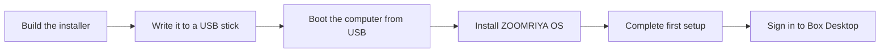

# Installing ZOOMRIYA OS

This guide explains how to install ZOOMRIYA OS on your own computer and set it
up as a ZOOMRIYA Box.

**The installer is still being developed.** It has been tested in a virtual
machine with `scripts/run-installer-vm.sh`, but not yet on physical computers.
There is no installer download yet, so you will need to build it yourself.
Expect rough edges, and use a computer with a drive you can safely erase.

## Installation at a glance



## What you need

- **A 64-bit PC (x86-64) that starts in UEFI mode,** with at least **4 GB of
  memory**.
- **A drive of 64 GB or more** for ZOOMRIYA OS. **Everything on it is
  erased.**
- **A USB stick of 2 GB or more** for the installer. It's erased too.
- **A keyboard, a mouse and a screen** plugged into the computer, for
  installing and the first setup.
- **An Ethernet cable to your router.** First setup waits for the cable, but
  you can connect the box to the internet later; installation does not need
  internet access.
- To build the installer: a computer running Debian 13, as described in the
  [README](../README.md#build-and-test).

## Sign-in is included

ZOOMRIYA OS includes [ZOOMRIYA ID](https://github.com/zoomriya/zoomriya-id),
the sign-in every ZOOMRIYA app shares. You don't install it separately: it's
built into the image, sets itself up the first time the box starts, and the
first setup makes your admin account in it. That's the account you sign in to
Box Desktop with.

Because the image includes ZOOMRIYA ID, check out its repository alongside
this one before building, or set `ZOOMRIYA_ID_SRC` to its location.

## 1. Build the installer

```sh
git clone https://github.com/zoomriya/zoomriya-os.git
git clone https://github.com/zoomriya/zoomriya-id.git
cd zoomriya-os
scripts/setup.sh            # installs what's missing (asks for sudo)
scripts/build-image.sh      # ZOOMRIYA OS: build/image/zoomriya-os.raw
scripts/build-installer.sh  # the USB installer, carrying it: build/installer/zoomriya-installer.raw
```

Before installing on a computer, you can try the process in a VM. Use an
empty 64 GB virtual drive:
`scripts/run-installer-vm.sh`, then `scripts/run-installer-vm.sh --target` to
start what it installed.

## 2. Write it to the USB stick

The installer is a disk image. Write the whole image to the USB stick; do
not copy the image file onto the stick as a regular file.

On Linux, find the stick's name with `lsblk` (by its size; for example
`/dev/sdb`), then:

```sh
sudo dd if=build/installer/zoomriya-installer.raw of=/dev/sdX bs=4M conv=fsync status=progress
```

Replace `/dev/sdX` with the device name for your USB stick. Check the device
name carefully before running the command: `dd` erases the drive it is given.
On other systems, use a disk-imaging tool to write the image to the stick.

## 3. Install

1. Plug the stick into the computer and boot from it. Most
   computers show a boot menu if you press a key while they start (often F12,
   F11, F8 or Esc; the screen usually says which).
2. **Welcome** checks that the computer started in UEFI mode, has enough
   memory and has a large enough drive. If it started in the older BIOS mode,
   change that in the computer's firmware settings and try again. Welcome
   also checks for an internet connection through the router. If there is no
   connection, the installer shows a warning but continues because ZOOMRIYA
   OS is on the stick. The box receives security updates once it is online.
3. **Drive:** Choose where to install ZOOMRIYA OS. Each drive shows what is on
   it now and what it will hold after installation. You cannot choose the USB
   stick or a drive that is too small.
4. **Summary:** Confirm that everything on the selected drive will be erased,
   then choose **Erase and install**.
5. **Install** takes a few minutes. When installation is **Done**, choose
   **Restart now**, or choose **Power off** if you want to move the computer
   before setting it up. Remove the USB stick.

If the stick doesn't start with Secure Boot on, turn Secure Boot off in the
computer's firmware settings for now.

## 4. First start

The computer boots from its drive and opens the first setup on its own screen.
The setup asks for the language and keyboard, the network (connect the
Ethernet cable), the country or region, the time zone, and an administrator
username and password of your choice. When setup is complete, Box Desktop's
sign-in appears. Sign in using the administrator account you just created.

After setup, ZOOMRIYA OS installs security fixes automatically during its
maintenance hour, which is 3:30 a.m. by default. You can change the time in
Control Panel › Restarts. The system keeps a restore point before and after
each update.

## Resetting the box

To set up the box from scratch, open Control Panel › Restore & Reset and
choose **Erase everything**. You will need your password and the box's setup
code. You can also reinstall from the USB stick.

A ZOOMRIYA Box comes with its setup code on a sticker. A computer you install
yourself generates a code the first time it starts. For now, the code is
written only to the system log; showing it during first setup is still
planned.
